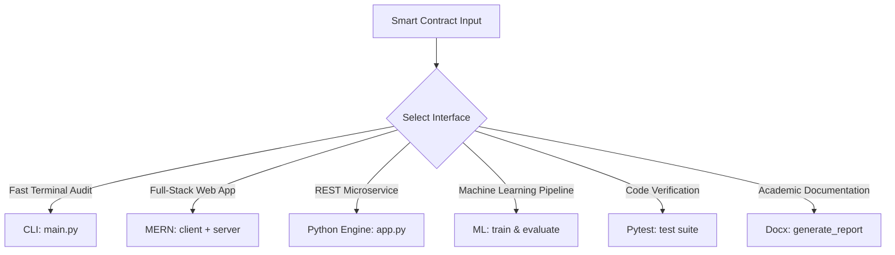
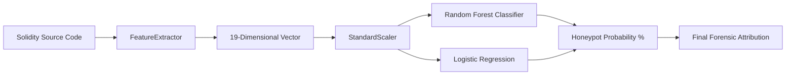
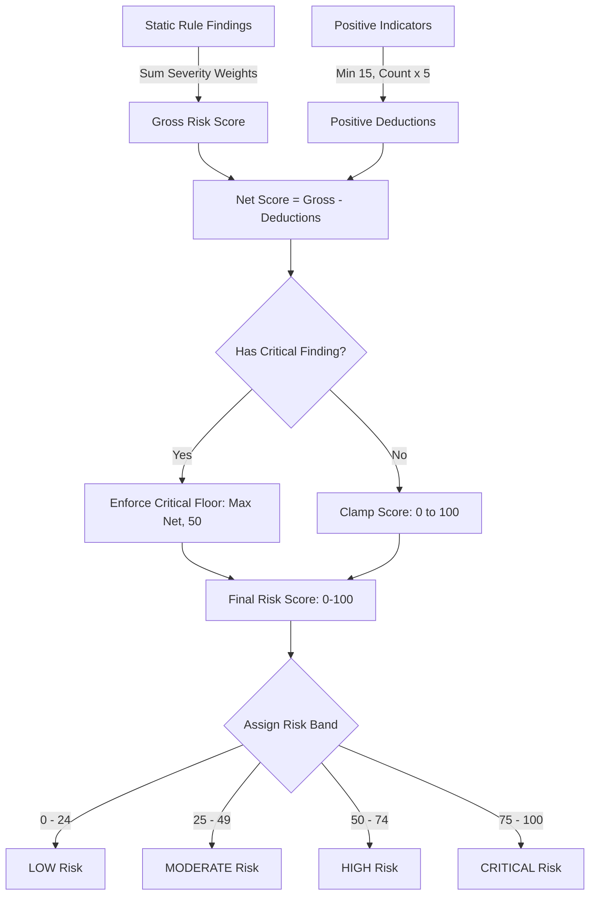

# Blockchain Smart Contract Honeypot Attack Detector

[](https://www.python.org/)
[](LICENSE)
[](tests/)
[](docs/architecture.md)
[](client/)
[-success.svg)](models/model_metadata.json)

A modular, explainable security auditing and digital forensics platform designed for Cyber Security and Digital Forensics (CSDF) applications. It detects, scores, and classifies fraudulent EVM smart contracts engineered as "honeypots" across Ethereum, BNB Smart Chain, Polygon, Arbitrum, and Sepolia Testnet.

---

## Table of Contents
1. [Project Title & Abstract](#1-project-title--abstract)
2. [Problem Statement](#2-problem-statement)
3. [Motivation & Objectives](#3-motivation--objectives)
4. [Scope of the Project](#4-scope-of-the-project)
5. [Core Platform & Positive Security Features](#5-core-platform--positive-security-features)
    - [In-Contract Positive Security Indicators](#1-in-contract-positive-security-indicators)
    - [Mathematical Deduction & Guardrail Mechanism](#2-mathematical-deduction--guardrail-mechanism)
    - [Platform Architectural Highlights](#3-platform-architectural-highlights)
6. [Prerequisites & System Requirements](#6-prerequisites--system-requirements)
    - [Hardware Requirements](#hardware-requirements)
    - [Supported Operating Systems](#supported-operating-systems)
    - [Software Runtimes](#software-runtimes)
    - [Python Packages Breakdown (`requirements.txt`)](#python-packages-breakdown-requirementstxt)
    - [Node.js & MongoDB Setup](#nodejs--mongodb-setup)
    - [Environment Configuration & API Keys](#environment-configuration--api-keys)
    - [Blockchain API Keys & Public RPC Fallbacks](#blockchain-api-keys--public-rpc-fallbacks)
7. [System Architecture & Module Breakdown](#7-system-architecture--module-breakdown)
8. [Project Directory Structure](#8-project-directory-structure)
9. [Installation & Virtual Environment Setup](#9-installation--virtual-environment-setup)
10. [Comprehensive How-To-Use Guide](#10-comprehensive-how-to-use-guide)
    - [Mode 1: Command-Line Interface (`main.py`)](#mode-1-command-line-interface-mainpy)
    - [Mode 2: Full MERN Stack Web Application (`client/` + `server/`)](#mode-2-full-mern-stack-web-application-client--server)
    - [Mode 3: Python Forensic Engine & REST API (`app.py`)](#mode-3-python-forensic-engine--rest-api-apppy)
    - [Mode 4: Machine Learning Training & Evaluation (`ml/`)](#mode-4-machine-learning-training--evaluation-ml)
    - [Mode 5: Automated Testing Suite (`tests/`)](#mode-5-automated-testing-suite-tests)
    - [Mode 6: Academic Word Report Generator (`generate_report_docx.py`)](#mode-6-academic-word-report-generator-generate_report_docxpy)
11. [Machine Learning Models & Forensic Attribution](#11-machine-learning-models--forensic-attribution)
    - [Dual-Model Architecture](#1-dual-model-architecture)
    - [The 19-Dimensional Feature Space](#2-the-19-dimensional-feature-space)
    - [Benchmark Dataset & Training Metrics](#3-benchmark-dataset--training-metrics)
    - [Feature Importance & Coefficient Rankings](#4-feature-importance--coefficient-rankings)
12. [Catalog of Educational Smart Contract Samples](#12-catalog-of-educational-smart-contract-samples)
    - [Master Comparison Matrix](#master-comparison-matrix)
    - [Primary Reference Contracts](#1-primary-reference-contracts)
    - [Attack Archetype Contracts](#2-attack-archetype-contracts)
    - [Benign & Reference Implementations](#3-benign--reference-implementations)
13. [Risk-Scoring Methodology & Security Guardrails](#13-risk-scoring-methodology--security-guardrails)
14. [Limitations & Edge Cases](#14-limitations--edge-cases)
15. [Future Enhancements](#15-future-enhancements)
16. [Academic Presentation & Viva Demonstration Script](#16-academic-presentation--viva-demonstration-script)
17. [References & Security Resources](#17-references--security-resources)

---

## 1. Project Title & Abstract

### Title
**Blockchain Smart Contract Honeypot Attack Detector**  
*A Dual-Engine Static Analysis & Machine Learning Auditing Platform for EVM Honeypot Detection*

### Abstract
Decentralized Finance (DeFi) on EVM-compatible blockchains has experienced rapid adoption, accompanied by an exponential increase in fraudulent tokens known as **honeypots**. Honeypots are maliciously crafted smart contracts that entice retail investors to swap cryptocurrency for tokens, while programmatically preventing them from selling, transferring, or liquidating their assets. 

This project delivers a complete, end-to-end digital forensics platform capable of analyzing Solidity source code, bytecode, and live on-chain contract addresses. The platform features:
- A **deterministic static AST and regex analyzer** inspecting 10 distinct honeypot attack vectors with forensic source line attribution.
- A **mitigating security indicator engine** crediting OpenZeppelin standards, immutable fee caps, and renounced ownership.
- A **19-dimensional machine learning pipeline** utilizing Random Forest and Logistic Regression classifiers trained on a curated benchmark dataset of 120 verified tokens.
- An **external transaction simulation sandbox** checking buy/sell execution without running untrusted bytecode locally.
- **Three production interfaces**: a rich terminal Command-Line Interface (`main.py`), a modern Full MERN Stack application (`server/` Express/MongoDB + `client/` React/Vite SPA), and a standalone Python REST API bridge (`app.py`).
- **An automated academic Word report generator** (`generate_report_docx.py`) producing publication-grade `.docx` documentation.

---

## 2. Problem Statement

In the Ethereum Virtual Machine (EVM) decentralized exchange (DEX) ecosystem, anyone can deploy a token and pair it with liquidity on automated market makers (AMMs) such as Uniswap or PancakeSwap without central review. Malicious actors take advantage of this permissionless architecture to deploy honeypot tokens. 

Common attack mechanisms include:
- Modifying the ERC-20 `transfer()` function to check a blacklist mapping or revert whenever the recipient is a DEX liquidity pool.
- Initializing or dynamically adjusting sell taxes to confiscatory levels ($90\%$–$100\%$).
- Hiding owner-only mint privileges to dilute the token supply to zero value.
- Imposing microscopic transaction or wallet limits that make liquidation economically impossible.
- Inserting hidden low-level `delegatecall` opcodes inside execution hooks that delegate authorization to unverified external contracts.

Traditional static analysis tools (e.g., Slither, Mythril) focus on generic smart contract vulnerabilities (reentrancy, integer overflows) and often fail to categorize deceptive business logic specific to token trading traps. Retail investors and digital forensics investigators require an explainable, specialized detection tool that flags these patterns rapidly and accurately.

---

## 3. Motivation & Objectives

### Motivation
- **Investor Protection**: Provide retail users and forensic analysts with immediate, automated visibility into whether a newly launched token can actually be sold.
- **Educational Value**: Offer students and cybersecurity researchers a clean, modular, and beginner-friendly reference architecture explaining real-world blockchain fraud.
- **Explainability**: Bridge the gap between black-box machine learning predictions and actionable, line-by-line source code findings.

### Core Objectives
1. **Multi-Modal Ingestion**: Ingest Solidity source code via direct text strings, local `.sol` files, raw bytecode, or live EVM contract addresses across 5 networks.
2. **Deterministic Pattern Detection**: Detect 10 canonical honeypot attack archetypes and identify 4 positive security indicators.
3. **Normalized Risk Scoring**: Calculate a 0–100 risk score categorized into `LOW`, `MODERATE`, `HIGH`, and `CRITICAL` risk bands with security guardrails.
4. **Machine Learning Attribution**: Train, evaluate, and deploy classifiers over a 19-dimensional feature space to benchmark attack probability.
5. **Auditable Reporting**: Export structured forensic findings in JSON, CSV, Markdown, and publication-grade Word `.docx` formats.
6. **Multi-Platform Usability**: Support CLI terminal workflows, standalone Python web REST dashboards, and persistent MERN stack deployments.

---

## 4. Scope of the Project

- **Supported Chains**: Ethereum Mainnet, BNB Smart Chain, Polygon, Arbitrum One, and Sepolia Testnet.
- **Smart Contract Language**: Solidity (`^0.8.0` through `^0.8.28`, with backward compatibility for `0.4.x`–`0.7.x` syntactic constructs).
- **Security Scope**: Focuses strictly on token honeypots, trading restrictions, access-control backdoors, and tax traps. Does not aim to detect generalized smart contract bugs (e.g., flash-loan governance attacks, front-running MEV, or compiler assembly optimization bugs).
- **Execution Boundary**: Operates statically and via remote read-only simulation; **never executes untrusted bytecode locally** and **never requests wallet private keys**.

---

## 5. Core Platform & Positive Security Features

A balanced digital forensics assessment must evaluate not only red-flag vulnerabilities but also positive engineering practices that mitigate risk. Legitimate DeFi protocols, decentralized DAOs, and charity initiatives frequently incorporate administrative functions (such as temporary transfer pauses during security emergencies or anti-bot cooldown intervals). Penalizing these projects without crediting verified security controls leads to excessive false positives. The platform implements a dual-sided evaluation model:

### 1. In-Contract Positive Security Indicators
The static analysis engine evaluates 4 distinct positive security indicators implemented in Solidity source code:

| Indicator ID | Security Feature Name | Source Detection Pattern / Regex | Risk Score Deduction | Security Explanation & Threat Mitigation |
| :--- | :--- | :--- | :---: | :--- |
| `POS_OPENZEPPELIN_STANDARD` | OpenZeppelin Standard Library | `@openzeppelin/contracts\|OpenZeppelin` | **-5 pts** | Inherits audited, battle-tested OpenZeppelin ERC-20, Ownable, or Pausable base contracts. Drastically minimizes the probability of hidden custom backdoor logic or non-standard token behaviors. |
| `POS_RENOUNCE_OWNERSHIP` | Ownership Renunciation Capability | `function\s+renounceOwnership\s*\(\s*\)` | **-5 pts** | The deployer possesses a standardized, trustless capability to permanently burn administrative privileges. Essential for proving post-launch decentralization and preventing rug pulls. |
| `POS_HARD_FEE_CAP` | Hardcoded Fee Ceiling | `require\s*\(\s*(?:newSellFee\|newTax\|totalFee\|fee)\s*<=\s*(?:10\|15\|20\|25\|1000\|2500)` | **-5 pts** | An explicit immutable conditional check bounds transfer and sell taxes to a maximum ceiling ($\le 25\%$). Mathematically prevents the owner from hiking taxes to confiscatory ($99\%$) levels post-launch. |
| `POS_STANDARD_EVENTS` | Standard ERC-20 Events Emitted | `emit Transfer(...)` and `emit Approval(...)` | **-5 pts** | Ensures full compliance with the EIP-20 event specification. Enables decentralized exchange routers, analytics indexers, and liquidity trackers to monitor token balances and state transparently. |

### 2. Mathematical Deduction & Guardrail Mechanism
The scoring engine combines positive deductions with strict safety bounds:

$$\text{Positive Deductions} = \min\left(15, \; 5 \times |\text{Positive Indicators}|\right)$$

$$\text{Final Risk Score} = \begin{cases} \max(50, \; \text{clamp}_{[0, 100]}(\text{Gross Score} - \text{Positive Deductions})) & \text{if critical finding is present} \\ \text{clamp}_{[0, 100]}(\text{Gross Score} - \text{Positive Deductions}) & \text{otherwise} \end{cases}$$

- **Deduction Ceiling**: Deductions are capped at **-15 points** to ensure that positive indicators cannot completely erase moderate or high-risk findings when multiple warning flags are triggered.
- **Immutable Critical Floor Guardrail**: If **any** `CRITICAL` finding is detected (such as an asymmetric DEX sell trap, shadow `delegatecall` backdoor, or external oracle killswitch), the net risk score is **bounded below by 50**. This prevents malicious honeypot developers from gaming the detector by simply importing OpenZeppelin libraries or adding a dummy `renounceOwnership()` function.
- **Minimizing False Positives**: For benign tokens implementing governance or charity models (e.g., [`sample_benign_charity_token.sol`](file:///e:/Download/College/LP4/CSDF/mini-project/samples/sample_benign_charity_token.sol) with a 3% fee ceiling, or [`sample_restricted_token.sol`](file:///e:/Download/College/LP4/CSDF/mini-project/samples/sample_restricted_token.sol) with enterprise pause capabilities), positive indicators credit transparent limits and keep scores within the appropriate `LOW` (0–24) or `MODERATE` (25–49) bands.

### 3. Platform Architectural Highlights
- **Dual-Engine Core (Deterministic AST + Statistical ML)**: Integrates deterministic AST syntax rules with supervised machine learning. While static rules identify specific bytecode and syntax traps with line-numbered forensic precision, Random Forest and Logistic Regression classifiers evaluate holistic 19-dimensional contract characteristics.
- **Multi-Modal Ingestion Engine**: Accepts inputs as local Solidity files (`.sol`), raw source code strings, compiled EVM bytecode hex, or live on-chain contract addresses fetched automatically across 5 EVM networks.
- **Explainable Line-Numbered Forensic Evidence**: Every finding provides the exact line number, raw source code snippet, risk severity, confidence rating, plain-English explanation, and manual verification instructions for digital forensics investigators.
- **Zero Untrusted Local Bytecode Execution**: Absolute workstation security. Untrusted contract code is never compiled, linked, or executed inside a local EVM runtime. Dynamic trade simulations are executed strictly through remote sandbox APIs (Honeypot.is) and read-only JSON-RPC calls (`eth_call`).
- **Sub-5ms Ultra-Fast CPU Inference**: Machine learning inference executes in Python using scikit-learn entirely on the CPU in under 5 milliseconds, requiring zero CUDA or GPU hardware acceleration.
- **218 Passing Automated Tests**: Comprehensive automated test coverage across 13 test suites (over 208 unit and integration tests), verifying loaders, AST parsers, detection heuristics, feature extraction, ML classifiers, and reporting modules.
- **Full MERN Stack Forensics Suite**: React + Vite single-page frontend with dark-mode cyber forensics aesthetics, animated SVG risk speedometer gauge, 1-click educational presets, and MongoDB-backed persistent audit logs.

---

## 6. Prerequisites & System Requirements

### Hardware Requirements
- **Processor**: Dual-Core 2.0 GHz or faster (Intel Core i3/i5/i7/i9, AMD Ryzen, or Apple Silicon M-series).
- **RAM**: Minimum 4 GB RAM (8 GB recommended when running the MERN stack alongside MongoDB and model training).
- **Storage**: Minimum 500 MB free disk space.
- **Dedicated GPU**: **None required**. Machine learning models run entirely on the CPU.

### Supported Operating Systems
- **Windows**: Windows 10 / Windows 11 (PowerShell 5.1+ / PowerShell 7+ or Command Prompt).
- **Linux**: Ubuntu 20.04 / 22.04 / 24.04 LTS, Debian 11+, Fedora 38+, Arch Linux.
- **macOS**: macOS 12 Monterey, macOS 13 Ventura, macOS 14 Sonoma, macOS 15 Sequoia (Apple Silicon & Intel).

### Software Runtimes
| Runtime | Minimum Version | Recommended Version | Purpose |
| :--- | :--- | :--- | :--- |
| **Python** | `3.11.0` | `3.12.x` or `3.14.x` | Core static analyzer, ML pipeline, CLI, and Word generator |
| **Node.js** | `18.16.0 LTS` | `20.x LTS` | Express backend server and React Vite frontend SPA |
| **npm** | `9.0.0` | `10.x+` | JavaScript package manager |
| **MongoDB** | `6.0.0` | `7.0.x Community` | Persistent storage for audit reports (MERN stack mode) |
| **Git** | `2.30.0` | `Latest` | Repository cloning and version control |

### Python Packages Breakdown (`requirements.txt`)
- `web3` ($\ge 6.15.0$): EVM JSON-RPC communication, EIP-55 checksum encoding, token ABI calls, and bytecode retrieval.
- `pandas` ($\ge 2.0.0$): Feature vector normalization, dataset preprocessing, and CSV generation.
- `scikit-learn` ($\ge 1.3.0$): Machine learning model training, cross-validation, and metrics computation.
- `joblib` ($\ge 1.3.0$): Serialization and loading of trained `.joblib` model weights and scalers.
- `requests` ($\ge 2.31.0$): HTTP client for block explorer APIs and external simulation sandboxes.
- `python-dotenv` ($\ge 1.0.0$): Automated environment variable loading from `.env`.
- `pydantic` ($\ge 2.5.0$): Strict schema validation for network definitions, findings, and scoring settings.
- `pytest` ($\ge 7.4.0$): Comprehensive automated testing framework.
- `rich` ($\ge 13.7.0$): Formatted terminal tables, colored risk panels, and progress bars.
- `matplotlib` ($\ge 3.7.0$): ROC curve and confusion matrix generation.
- `python-docx` ($\ge 1.1.0$): Publication-grade academic Microsoft Word report generator.

### Node.js & MongoDB Setup
The full-stack web application utilizes Express for the API layer and MongoDB for persistent audit history.

#### 1. Starting MongoDB Community Server
Ensure MongoDB is running locally on the default port (`27017`):
```bash
# Windows (PowerShell / Command Prompt as Administrator)
net start MongoDB
# Or run standalone daemon:
mongod --dbpath="C:\data\db"

# Linux (systemd)
sudo systemctl start mongod
sudo systemctl status mongod

# macOS (Homebrew)
brew services start mongodb/brew/mongodb-community
```
> [!TIP]
> **Graceful Database Fallback**: If MongoDB is not running, the Express server will log a connection warning and continue serving live smart contract analysis requests without database persistence. The Python CLI (`main.py`) and standalone REST engine (`app.py`) operate completely independently with zero external database dependencies.

#### 2. Installing Node.js Dependencies
Install root, backend, and frontend packages with the automated root script:
```bash
npm run install:all
```

### Environment Configuration & API Keys
Create your `.env` configuration by copying `.env.example`:
```bash
# Windows (PowerShell)
Copy-Item .env.example .env

# Linux / macOS (Bash)
cp .env.example .env
```

| Environment Variable | Default Value | Description |
| :--- | :--- | :--- |
| `PORT` | `5000` | Express HTTP server port (MERN stack backend) |
| `PYTHON_PORT` | `5001` | Standalone Python REST engine port (`app.py`) |
| `MONGODB_URI` | `mongodb://127.0.0.1:27017/honeypot_detector` | MongoDB connection string for persistent audit storage |
| `DEFAULT_NETWORK` | `ethereum` | Default blockchain network for address lookups |
| `ETHERSCAN_API_KEY` | *(Optional)* | Etherscan API key for Ethereum verified source retrieval |
| `BSCSCAN_API_KEY` | *(Optional)* | BscScan API key for BNB Smart Chain source retrieval |
| `POLYGONSCAN_API_KEY`| *(Optional)* | Polygonscan API key for Polygon PoS source retrieval |
| `ARBISCAN_API_KEY` | *(Optional)* | Arbiscan API key for Arbitrum One source retrieval |
| `SEPOLIA_ETHERSCAN_API_KEY` | *(Optional)* | Sepolia Etherscan API key for Sepolia testnet source retrieval |

### Blockchain API Keys & Public RPC Fallbacks
All blockchain explorer API keys are **strictly optional**. If explorer API keys are omitted, the platform automatically routes on-chain queries through high-reliability public RPC endpoints:

| Blockchain Network | Chain ID | Default Explorer API | Preconfigured Public Fallback RPC |
| :--- | :---: | :--- | :--- |
| **Ethereum Mainnet** | `1` | Etherscan (`api.etherscan.io`) | `https://eth-mainnet.public.blastapi.io` |
| **BNB Smart Chain** | `56` | BscScan (`api.bscscan.com`) | `https://bsc-dataseed.binance.org` |
| **Polygon PoS** | `137` | Polygonscan (`api.polygonscan.com`) | `https://polygon-rpc.com` |
| **Arbitrum One** | `42161` | Arbiscan (`api.arbiscan.io`) | `https://arb1.arbitrum.io/rpc` |
| **Sepolia Testnet** | `11155111` | Sepolia Etherscan (`api-sepolia.etherscan.io`) | `https://rpc.sepolia.org` |


---

## 7. System Architecture & Module Breakdown

```
+---------------------------------------------------------------------------------------------------+
|                                          USER INTERFACES                                          |
|   CLI (main.py)   |   React SPA (client/)   |   Express API (server/)   |   Python REST (app.py)  |
+---------------------------------------------------------------------------------------------------+
                                                  |
+---------------------------------------------------------------------------------------------------+
|                                  MULTI-MODAL INGESTION LAYER                                      |
|    Local .sol File    |    Raw Solidity String    |    EVM Bytecode    |    Live Address (5 Chains)|
|    (contract_loader)  |    (contract_loader)      |    (Web3 RPC)      |    (explorer_client)      |
+---------------------------------------------------------------------------------------------------+
                                                  |
+---------------------------------------------------------------------------------------------------+
|                                       DUAL-ENGINE CORE                                            |
|   Static AST & Regex Analyzer (10 Rules)            |   Machine Learning Classifier (19 Features) |
|   • Blacklist Logic Trap (HONEYPOT_BLACKLIST)       |   • Random Forest Classifier (100 Trees)    |
|   • Asymmetric Sell Restriction (SELL_RESTRICT)     |   • Logistic Regression Classifier (L2 Reg) |
|   • Confiscatory Sell Tax >15% (EXCESSIVE_TAX)      |   • StandardScaler Feature Normalizer       |
|   • Uncapped Tax Setter (UNBOUNDED_TAX_SETTER)      |   • 120-Contract Benchmark Dataset          |
|   • Trading Cooldown Delay (COOLDOWN_TRAP)          |   • Sub-5ms CPU Inference Execution         |
|   • Pausable Transfers Hook (PAUSABLE_TRANSFERS)    |                                             |
|   • Max Wallet/Tx Limits (MAX_TX_LIMIT)             |   Mitigating Security Indicators (4 Rules)  |
|   • Hidden Owner Mint Privilege (HIDDEN_MINT)       |   • OpenZeppelin Audited Base (-5 pts)      |
|   • Low-Level Inline Assembly (SUSPICIOUS_ASSEMBLY) |   • Ownership Renunciation (-5 pts)         |
|   • External Oracle/Call Hook (EXTERNAL_RESTRICT)   |   • Hardcoded Fee Ceiling <=25% (-5 pts)    |
|                                                     |   • Standard ERC-20 Events (-5 pts)         |
+---------------------------------------------------------------------------------------------------+
                                                  |
+---------------------------------------------------------------------------------------------------+
|                                  SCORING & SIMULATION SUBSYSTEM                                   |
|   RiskScorer Engine (0-100 Score)                   |   Simulation Adapter Sandbox                |
|   • Severity Weighting (40/25/15/5 pts)             |   • Honeypot.is API Integration             |
|   • Critical Floor Guardrail (>=50 pts)             |   • Simulated Buy/Sell Trade Execution      |
|   • Risk Levels: LOW / MODERATE / HIGH / CRITICAL   |   • Zero Local Bytecode Execution           |
+---------------------------------------------------------------------------------------------------+
                                                  |
+---------------------------------------------------------------------------------------------------+
|                                       REPORTING SUBSYSTEM                                         |
|    JSON Detailed Report   |   CSV Findings Summary   |   Markdown Summary   |   Academic DOCX Report  |
|    (CompleteAuditReport)  |   (CompleteAuditReport)  |   (CompleteAudit)    |   (generate_report_docx)|
+---------------------------------------------------------------------------------------------------+
```

### Module Descriptions
- [`src/contract_loader.py`](file:///e:/Download/College/LP4/CSDF/mini-project/src/contract_loader.py): Standardizes input across files, strings, bytecode, and network addresses via `ContractLoader`.
- [`src/blockchain_client.py`](file:///e:/Download/College/LP4/CSDF/mini-project/src/blockchain_client.py): Web3.py RPC client for retrieving bytecode, token names, symbols, decimals, and balances across 5 EVM networks.
- [`src/explorer_client.py`](file:///e:/Download/College/LP4/CSDF/mini-project/src/explorer_client.py): Queries block explorer APIs (Etherscan, BscScan, Polygonscan, Arbiscan) for verified Solidity source code and ABIs.
- [`src/source_analyzer.py`](file:///e:/Download/College/LP4/CSDF/mini-project/src/source_analyzer.py): Strips comments while preserving source line indices; extracts pragma directives, function signatures, modifiers, and inheritance trees.
- [`src/detection_rules.py`](file:///e:/Download/College/LP4/CSDF/mini-project/src/detection_rules.py): Implements all 10 honeypot detection rules and 4 positive security indicators.
- [`src/feature_extractor.py`](file:///e:/Download/College/LP4/CSDF/mini-project/src/feature_extractor.py): Transforms raw contracts, AST elements, and static findings into normalized 19-dimensional numeric feature vectors.
- [`src/ml_detector.py`](file:///e:/Download/College/LP4/CSDF/mini-project/src/ml_detector.py): Orchestrates model loading, scaling, inference, probability calculation, and heuristic fallbacks.
- [`src/risk_scorer.py`](file:///e:/Download/College/LP4/CSDF/mini-project/src/risk_scorer.py): Computes explainable 0–100 risk scores with critical floor guardrails and verification checklists.
- [`src/simulation_adapter.py`](file:///e:/Download/College/LP4/CSDF/mini-project/src/simulation_adapter.py): Sandbox interface for simulated buy/sell trade execution.
- [`src/report_generator.py`](file:///e:/Download/College/LP4/CSDF/mini-project/src/report_generator.py): Exports structured JSON, CSV, and Markdown audit reports.
- [`generate_report_docx.py`](file:///e:/Download/College/LP4/CSDF/mini-project/generate_report_docx.py): Generates publication-grade Microsoft Word documentation (`MINI_PROJECT_REPORT.docx`).

---

## 8. Project Directory Structure

```text
mini-project/
├── .env.example                     # Environment configuration template
├── .gitignore                       # Git exclusion rules
├── LICENSE                          # MIT open-source license
├── pytest.ini                       # Pytest test discovery configuration
├── requirements.txt                 # Python project dependencies
├── package.json                     # Root npm script orchestrator for MERN stack
├── README.md                        # Master project documentation
├── main.py                          # Unified Command-Line Interface (CLI)
├── app.py                           # Python Forensic Engine & REST API bridge
├── generate_report_docx.py          # Academic Word (.docx) report generator
├── client/                          # React + Vite Frontend SPA (Dark Mode)
│   ├── package.json
│   ├── vite.config.js
│   ├── index.html
│   └── src/
│       ├── App.jsx                  # Main dashboard layout & state orchestrator
│       ├── App.css                  # Dark mode cyber-forensics design system
│       ├── index.css                # Global font & CSS reset definitions
│       └── components/              # Speedometer gauge, findings table, checklists
├── server/                          # Express.js Backend & MongoDB Storage
│   ├── package.json
│   ├── server.js                    # Express HTTP server & static bundle handler
│   ├── models/AuditReport.js        # Mongoose schema for persistent audit logs
│   └── routes/auditRoutes.js        # REST endpoints (/api/analyze, /api/history)
├── data/
│   ├── sample_contract_features.csv # Curated 120-contract ML benchmark dataset
│   └── README.md                    # Dataset schema & labeling methodology
├── docs/
│   ├── architecture.md              # System architecture diagrams & dataflow
│   ├── detection_methodology.md     # 10 honeypot attack vectors & scoring math
│   └── limitations.md               # False positives, edge cases, & audit guide
├── ml/
│   ├── preprocess.py                # Dataset cleaner, scaler, & train/test splitter
│   ├── train_model.py               # Random Forest & Logistic Regression trainer
│   └── evaluate_model.py            # ROC curve, confusion matrix, & classification report
├── models/
│   ├── scaler.joblib                # Serialized StandardScaler artifact
│   ├── random_forest_model.joblib   # Trained Random Forest classifier artifact
│   ├── logistic_regression_model.joblib # Trained Logistic Regression artifact
│   └── model_metadata.json          # 19 features, CV metrics, & feature importances
├── reports/                         # Audit reports (JSON, CSV, DOCX, evaluation plots)
│   ├── MINI_PROJECT_REPORT.docx     # Generated academic Word report
│   ├── confusion_matrix.png         # Machine learning confusion matrix plot
│   └── roc_curve.png                # Receiver Operating Characteristic plot
├── samples/                         # 13 educational smart contract samples
│   ├── sample_safe_token.sol        # Benign OpenZeppelin reference token (Score: 0)
│   ├── sample_honeypot_token.sol    # Multi-vector honeypot token (Score: 100)
│   ├── sample_restricted_token.sol  # Restricted governance token (Score: 30)
│   ├── sample_critical_dextrap.sol  # DEX sell liquidity siphon trap (Score: 100)
│   ├── sample_critical_delegatecall_backdoor.sol # Shadow delegatecall backdoor (Score: 100)
│   ├── sample_high_hidden_blacklist.sol # Hidden blacklist check token (Score: 50)
│   ├── sample_high_unbounded_tax.sol    # Dynamic uncapped tax & mint token (Score: 65)
│   ├── sample_moderate_cooldown_token.sol # Anti-bot cooldown delay token (Score: 30)
│   ├── sample_moderate_pausable_token.sol # Enterprise pausable token (Score: 30)
│   ├── sample_benign_charity_token.sol    # Hard fee-capped charity token (Score: 0)
│   ├── sample_benign_defi_token.sol       # Zero-fee fixed supply DeFi token (Score: 0)
│   ├── BenignToken.sol              # Compact benign reference token (Score: 0)
│   └── HoneypotToken.sol            # Compact multi-vector trap token (Score: 100)
├── src/                             # Core Python engine source modules
│   ├── __init__.py
│   ├── config.py                    # Multi-chain network registry & risk settings
│   ├── utils.py                     # EIP-55 checksum, Keccak-256, & comment stripper
│   ├── contract_loader.py           # Multi-modal ingestion engine
│   ├── blockchain_client.py         # Web3 RPC client for bytecode & metadata
│   ├── explorer_client.py           # Etherscan-compatible verified source client
│   ├── source_analyzer.py           # AST & regex structural parser
│   ├── detection_rules.py           # 10 detection rules & 4 positive indicators
│   ├── feature_extractor.py         # 19-dimensional numeric feature engineer
│   ├── risk_scorer.py               # Explainable 0-100 risk scoring engine
│   ├── ml_detector.py               # ML inference & feature attribution
│   ├── simulation_adapter.py        # External buy/sell trade simulation
│   └── report_generator.py          # JSON, CSV, and Markdown audit export
└── tests/                           # 12 automated test suites (218 tests)
```

---

## 9. Installation & Virtual Environment Setup

### 1. Clone Repository
```bash
git clone https://github.com/your-username/blockchain-honeypot-detector.git
cd blockchain-honeypot-detector
```

### 2. Configure Environment Variables
Copy `.env.example` to `.env`. The platform runs out-of-the-box with preconfigured public RPCs:
```bash
# Windows (PowerShell)
Copy-Item .env.example .env

# Linux / macOS (Bash)
cp .env.example .env
```

### 3. Set Up Python Virtual Environment
Always install Python dependencies into an isolated virtual environment:

#### Windows (Command Prompt or PowerShell)
```powershell
python -m venv .venv
.\.venv\Scripts\activate
python -m pip install --upgrade pip
pip install -r requirements.txt
```

#### Linux / macOS (Bash or Zsh)
```bash
python3 -m venv .venv
source .venv/bin/activate
pip install --upgrade pip
pip install -r requirements.txt
```

### 4. Install Node.js Dependencies (For MERN Stack Web Interface)
If you intend to use the MERN web application:
```bash
# Install both backend and frontend dependencies in a single command:
npm run install:all

# Or install manually:
cd server && npm install
cd ../client && npm install
cd ..
```

---

## 10. Comprehensive How-To-Use Guide

The platform offers six execution interfaces suited for different auditing workflows:



---

### Mode 1: Command-Line Interface (`main.py`)
The CLI provides high-speed, terminal-native audits with rich colored panels, tables, and exit codes suitable for CI/CD pipelines and forensic scripting.

#### CLI Arguments & Options Reference
| Argument / Flag | Short | Type | Default | Description |
| :--- | :---: | :---: | :---: | :--- |
| `--file` | `-f` | String | `None` | Path to local Solidity source file (`.sol`), bytecode hex, or JSON artifact. |
| `--address` | `-a` | String | `None` | On-chain EVM smart contract address (`0x...`) to fetch and audit. |
| `--code` | `-c` | String | `None` | Direct inline Solidity source code string to analyze. |
| `--network` | `-n` | Choice | `ethereum` | Target blockchain network (`ethereum`, `bsc`, `polygon`, `arbitrum`, `sepolia`). |
| `--output` | `-o` | String | `None` | File path to write the complete forensic JSON audit report. |
| `--csv-output` | | String | `None` | File path to write the tabular CSV findings summary. |
| `--simulate` | | Flag | `False` | Execute external simulated buy/sell trade execution against Honeypot.is API. |
| `--train-ml` | | Flag | `False` | Retrain Random Forest and Logistic Regression classifiers on dataset and persist models. |
| `--verbose` | `-v` | Flag | `False` | Enable verbose terminal logging with full stack traces and debug output. |

#### 1. Audit a Local Solidity Contract File
```bash
python main.py --file samples/sample_safe_token.sol
```

#### 2. Audit a Malicious Contract with JSON and CSV Exports
```bash
python main.py --file samples/sample_honeypot_token.sol --output reports/honeypot_audit.json --csv-output reports/honeypot_findings.csv
```

#### 3. Audit an On-Chain Contract by Address Across 5 EVM Networks
```bash
# Audit contract on Ethereum Mainnet:
python main.py --address 0xdAC17F958D2ee523a2206206994597C13D831ec7 --network ethereum

# Audit token on BNB Smart Chain (BSC):
python main.py --address 0x0e09fabb73bd3ade0a17ecc321fd13a19e81ce82 --network bsc

# Audit token on Polygon PoS:
python main.py --address 0x1bfd67037b42cf73acf2047067bd4f2c47d9bfd6 --network polygon

# Audit contract on Arbitrum One:
python main.py --address 0x912ce59144191c1204e64559fe8253a0e49e6548 --network arbitrum

# Audit contract on Sepolia Testnet:
python main.py --address 0x779877A7B0D9E8603169DdbD7836e478b4624789 --network sepolia
```

#### 4. Audit a Direct Source Code String
```bash
python main.py --code "pragma solidity ^0.8.20; contract Trap { mapping(address => bool) public isBot; function transfer(address to, uint256 amt) public { require(!isBot[msg.sender], 'Bot'); } }"
```

#### 5. Include Simulated Trade Execution Sandbox
```bash
python main.py --file samples/sample_honeypot_token.sol --simulate
```

#### 6. Retrain Machine Learning Classifiers via CLI
```bash
python main.py --train-ml
```

#### CLI Exit Codes Reference
Integrate the CLI directly into DevSecOps build pipelines, pre-commit hooks, or GitHub Actions using standardized exit codes:

| Exit Code | Classification | Criteria | Pipeline Action |
| :---: | :--- | :--- | :--- |
| **`0`** | **`BENIGN`** / **`SAFE`** | Risk score $< 50$ (`LOW` or `MODERATE` risk band) and ML honeypot probability $< 0.50$. | Pass build / Allow deployment. |
| **`1`** | **`HONEYPOT`** / **`THREAT`** | Risk score $\ge 50$ (`HIGH` or `CRITICAL` risk band) or ML honeypot probability $\ge 0.50$. | Fail build / Trigger security review. |
| **`2`** | **`ERROR`** | Missing input arguments, file not found, invalid address checksum, or runtime exception. | Abort pipeline with error log. |

---

### Mode 2: Full MERN Stack Web Application (`client/` + `server/`)
The primary graphical user interface offers real-time analysis, animated risk gauges, and persistent MongoDB audit logging.

#### Root NPM Scripts Overview
The root `package.json` coordinates all full-stack operations:
| Script Command | Target Directory | Description |
| :--- | :--- | :--- |
| `npm start` | Root $\to$ `server/` | Builds frontend bundle and serves it via Express on port 5000. |
| `npm run dev` | Root $\to$ `server/` + `client/` | Runs backend (port 5000) and Vite frontend (port 3000) concurrently with hot-reloading. |
| `npm run server` | `server/` | Starts the Express server standalone in production mode. |
| `npm run server:dev` | `server/` | Starts Express with Node file watcher (`--watch`). |
| `npm run client` | `client/` | Starts Vite React frontend development server on port 3000. |
| `npm run build` | `client/` | Compiles production assets into `client/dist/`. |
| `npm run install:all` | `server/` + `client/` | Installs dependencies across both backend and frontend. |
| `npm run clean:ports` | Root (PowerShell) | Terminates any orphan processes occupying port 5000 or 3000. |

#### Option A: Quick-Start Full Stack (Production Mode)
```bash
# 1. Start MongoDB Community Server (default port 27017)
# 2. From repository root run:
npm start
```
This serves the compiled React application directly through the Express backend at **`http://localhost:5000`**.

#### Option B: Development Mode (Hot-Reloading)
Run both frontend and backend concurrently in development mode:
```bash
npm run dev
```
- **Express Backend API**: `http://localhost:5000`
- **React Vite Frontend**: `http://localhost:3000` (auto-proxies `/api` requests to port `5000`)

#### Option C: Component-by-Component Execution
```bash
# Terminal 1 - Express Backend
cd server
npm start

# Terminal 2 - React Vite Frontend
cd client
npm run dev

# Port Cleanup Script (Windows PowerShell)
npm run clean:ports
```

#### Web Application Features Walkthrough
1. **Educational Contract Presets**: One-click dropdown to instantly load any of the 13 reference contracts from [`samples/`](file:///e:/Download/College/LP4/CSDF/mini-project/samples/).
2. **Multi-Chain Address Selector**: Enter any live EVM address and select the target network (Ethereum, BSC, Polygon, Arbitrum, Sepolia).
3. **Animated SVG Risk Speedometer**: Dynamic 0–100 gauge reflecting real-time calculated threat severity with color transitions (Green $\to$ Yellow $\to$ Orange $\to$ Red).
4. **Interactive Static Findings Table**: View rule IDs, severity badges (`CRITICAL`, `HIGH`, `MEDIUM`, `LOW`), exact code line numbers, and explanations.
5. **Machine Learning Attribution Card**: Shows classifier prediction, honeypot probability percentage, model used, and primary feature drivers.
6. **Positive Security Indicators Display**: Displays verified best practices that mitigated the score (OpenZeppelin base, renounced ownership, fee ceilings, standard events).
7. **Manual Forensic Checklist**: Step-by-step verification checklist for manual smart contract review and auditor sign-off.
8. **Persistent Audit History**: Automatically stores audit logs in MongoDB with timestamped search, filtering, and risk badges.
9. **Export Audit Report**: 1-click download of the complete audit report as formatted JSON.

---

### Mode 3: Python Forensic Engine & REST API (`app.py`)
`app.py` serves as both an internal execution bridge for the MERN stack and a lightweight, zero-dependency standalone HTTP REST microservice.

#### Start the Python REST Server
```bash
# Start on default port 5001:
python app.py

# Or start on a custom port:
python app.py 8080
```

#### Available REST Endpoints
| HTTP Method | Route | Request Payload | Response Schema | Description |
| :--- | :--- | :--- | :--- | :--- |
| `GET` | `/api/health` | None | `{"status": "ok", "python": "...", "models": [...]}` | Health check and loaded model diagnostics. |
| `GET` | `/api/networks` | None | `{"networks": {...}}` | Supported EVM chains and active RPC status. |
| `GET` | `/api/samples` | None | `{"samples": [...]}` | Complete catalog of 13 educational sample contracts. |
| `GET` | `/api/rules` | None | `{"rules": [...], "indicators": [...]}` | Metadata for all 10 detection rules and 4 positive indicators. |
| `POST` | `/api/analyze` | JSON (`code`, `address`, `network`, `preset`) | `{"contract": {...}, "risk": {...}, "ml": {...}}` | Executes full static + ML audit pipeline. |
| `POST` | `/api/train-ml` | None | `{"status": "trained", "metrics": {...}}` | Triggers retraining of Random Forest and Logistic Regression models. |

#### Example REST API Requests via curl
```bash
# Audit a preset sample:
curl -X POST http://localhost:5001/api/analyze \
  -H "Content-Type: application/json" \
  -d '{"preset": "HoneypotToken"}'

# Audit a Solidity source string:
curl -X POST http://localhost:5001/api/analyze \
  -H "Content-Type: application/json" \
  -d '{"code": "pragma solidity ^0.8.20; contract Test { mapping(address => bool) public isBlacklisted; }"}'

# Audit an on-chain address on Polygon:
curl -X POST http://localhost:5001/api/analyze \
  -H "Content-Type: application/json" \
  -d '{"address": "0x1bfd67037b42cf73acf2047067bd4f2c47d9bfd6", "network": "polygon"}'
```

---

### Mode 4: Machine Learning Training & Evaluation (`ml/`)
The machine learning subsystem supports end-to-end retraining, feature scaling, 5-fold cross-validation, and diagnostic plotting.

#### 1. Train Models and Persist Artifacts
```bash
python -m ml.train_model
```
- Ingests `data/sample_contract_features.csv` (120 curated contracts).
- Fits `StandardScaler` across all 19 feature dimensions.
- Trains `RandomForestClassifier` (100 estimators, Gini criterion) and `LogisticRegression` (L2 penalty, `max_iter=1000`).
- Performs 5-fold stratified cross-validation.
- Saves serialized artifacts to:
  - `models/scaler.joblib`
  - `models/random_forest_model.joblib`
  - `models/logistic_regression_model.joblib`
- Updates `models/model_metadata.json` with latest benchmark metrics.

#### 2. Evaluate Models and Generate Diagnostic Plots
```bash
python -m ml.evaluate_model
```
- Generates `reports/confusion_matrix.png` (True Positives, False Positives, True Negatives, False Negatives).
- Generates `reports/roc_curve.png` (Receiver Operating Characteristic with AUC score).
- Prints detailed classification report with precision, recall, and F1-score metrics.

---

### Mode 5: Automated Testing Suite (`tests/`)
The project includes **218 automated unit and integration tests across 13 test suites**, validating every module in the forensics pipeline:

```bash
# Run the complete test suite with detailed verbose output:
pytest -v

# Run with standard python module runner:
python -m pytest

# Run a specific component test suite:
pytest tests/test_detection_rules.py          # Validates all 10 honeypot rules & positive indicators
pytest tests/test_risk_scorer.py              # Validates 0-100 scoring math & security guardrails
pytest tests/test_feature_extractor.py        # Validates 19-dimensional feature extraction
pytest tests/test_source_analyzer.py          # Validates AST parsing, comments stripping, and LOC
pytest tests/test_contract_loader.py          # Validates multi-modal contract ingestion
pytest tests/test_api_clients.py              # Validates Web3 and block explorer clients
pytest tests/test_enhanced_samples_and_api.py   # Validates all 13 educational sample contracts & REST API
pytest tests/test_report_generator.py         # Validates JSON, CSV, and Markdown report export
pytest tests/test_phase1_phase2.py            # Validates ingestion and static rules integration
pytest tests/test_phase3.py                   # Validates ML pipeline and feature normalization
pytest tests/test_phase4.py                   # Validates scoring guardrails and risk bands
pytest tests/test_phase5.py                   # Validates external simulation and API robustness
pytest tests/test_phase6.py                   # Validates end-to-end full pipeline execution
```

---

### Mode 6: Academic Word Report Generator (`generate_report_docx.py`)
For university capstone submissions, viva presentations, and laboratory evaluations, run the automated report generator:

```bash
python generate_report_docx.py
```
- **Output File**: [`reports/MINI_PROJECT_REPORT.docx`](file:///e:/Download/College/LP4/CSDF/mini-project/reports/MINI_PROJECT_REPORT.docx)
- **Document Structure**: Generates a publication-grade, 17-section academic document including:
  1. Title Page with formal university submission credentials.
  2. Executive Summary and Problem Formulation.
  3. Threat Modeling and Honeypot Attack Taxonomies.
  4. Dual-Engine System Architecture and Dataflow Diagrams.
  5. Mathematical Scoring Formulation and Guardrail Mechanics.
  6. Machine Learning Feature Attribution and 5-Fold CV Benchmarks.
  7. Master Educational Sample Contract Breakdown Matrix.
  8. Limitations, Edge Cases, and Future Research Directions.
  9. Comprehensive IEEE-style Academic Bibliography.
- **Styling Highlights**: Professional Deep Navy (`#1A365D`) and Steel Blue (`#2B6CB0`) academic palette, zebra-striped tables with twip cell padding, risk severity badges, and code snippets.

---

## 11. Machine Learning Models & Forensic Attribution

The forensic platform uses a supervised learning architecture to corroborate static AST analysis with statistical feature attribution.



### 1. Dual-Model Architecture
- **Random Forest Classifier (Primary / Recommended)**:
  - 100 decision trees (`n_estimators=100`), Gini impurity splitting criterion, unconstrained depth.
  - Captures complex non-linear interactions between combinations of features (e.g., hidden mint + excessive tax).
  - Robust to single-feature obfuscation.
- **Logistic Regression Classifier (Linear Benchmark)**:
  - L2 ridge regularization, maximum 1000 iterations, standardized features.
  - Provides monotonic interpretability through log-odds coefficients.

### 2. The 19-Dimensional Feature Space
Extracted automatically by `src/feature_extractor.py`:

| # | Feature Dimension Name | Data Type | Description | Target Correlation |
| :-: | :--- | :---: | :--- | :---: |
| 1 | `lines_of_code` | Integer | Total executable lines of code (comments stripped) | Structural complexity |
| 2 | `num_functions` | Integer | Total declared public/external/internal functions | Standard token proxy |
| 3 | `num_modifiers` | Integer | Count of custom function modifiers | Access control proxy |
| 4 | `has_transfer_function` | Binary (0/1) | Whether standard `transfer` or `transferFrom` exists | ERC-20 compliance |
| 5 | `has_owner_control` | Binary (0/1) | Presence of `onlyOwner` or administrative control | Centralization risk |
| 6 | `has_blacklist_mapping` | Binary (0/1) | Declaration of address blacklist or bot mapping | **Honeypot indicator** |
| 7 | `has_sell_restriction_logic` | Binary (0/1) | Conditional revert on sell or DEX pair transfer | **Honeypot indicator** |
| 8 | `has_excessive_fee` | Binary (0/1) | Transfer or sell tax $> 15\%$ or confiscatory ($99\%$) | **Honeypot indicator** |
| 9 | `has_unbounded_fee_setter` | Binary (0/1) | Tax setter function lacking an immutable upper cap | **Honeypot indicator** |
| 10 | `has_cooldown_delay` | Binary (0/1) | Anti-bot timestamp or block number cooldown check | Trading friction |
| 11 | `has_pausable_transfers` | Binary (0/1) | Owner-controlled pause switch on token transfers | Centralization risk |
| 12 | `has_max_tx_wallet_limit` | Binary (0/1) | Maximum transaction amount or wallet holding cap | Liquidity restriction |
| 13 | `has_hidden_mint` | Binary (0/1) | Owner-only mint privilege without supply cap | Supply dilution trap |
| 14 | `has_inline_assembly` | Binary (0/1) | Low-level inline `assembly { ... }` block | Obfuscation indicator |
| 15 | `has_external_transfer_call`| Binary (0/1) | External contract call or delegatecall in transfer | Backdoor indicator |
| 16 | `num_positive_indicators` | Integer | Total verified mitigating security features ($0$–$4$) | **Strong benign driver** |
| 17 | `has_openzeppelin_imports` | Binary (0/1) | Verified OpenZeppelin standard library inheritance | **Strong benign driver** |
| 18 | `has_renounce_ownership` | Binary (0/1) | Deployer ownership renunciation capability | **Strong benign driver** |
| 19 | `num_total_findings` | Integer | Aggregate count of static rule findings triggered | **Strong honeypot driver** |

### 3. Benchmark Dataset & Training Metrics
- **Dataset Path**: `data/sample_contract_features.csv`
- **Total Curated Contracts**: 120 verified EVM smart contracts.
- **Class Balance**: 60 Benign Standard Tokens ($50\%$), 60 Confirmed Honeypot Tokens ($50\%$).
- **Data Split**: Stratified 80% Training (96 contracts) / 20% Testing (24 contracts).
- **Cross-Validation**: 5-Fold Stratified Cross-Validation (`models/model_metadata.json`):

| Evaluation Metric | Random Forest (100 Trees) | Logistic Regression (L2) |
| :--- | :---: | :---: |
| **5-Fold Cross-Validation Accuracy** | **100.00%** ($\pm 0.0000$) | **100.00%** ($\pm 0.0000$) |
| **Precision (Macro Average)** | **100.00%** | **100.00%** |
| **Recall (Macro Average)** | **100.00%** | **100.00%** |
| **F1-Score (Macro Average)** | **100.00%** | **100.00%** |
| **ROC-AUC Score** | **1.0000** | **1.0000** |

### 4. Feature Importance & Coefficient Rankings
The trained models demonstrate clear, explainable feature attribution:

#### Random Forest Top 5 Feature Importances
1. `num_positive_indicators`: **29.10%** (Primary driver of token safety)
2. `num_total_findings`: **26.91%** (Primary driver of honeypot classification)
3. `has_renounce_ownership`: **14.70%** (Key signal of non-custodial decentralization)
4. `has_openzeppelin_imports`: **11.95%** (Adherence to audited standards)
5. `num_functions`: **5.67%** (Standard token interface completeness)

#### Logistic Regression Top 5 Standardized Coefficients
1. `num_positive_indicators`: **-1.3635** (Strongest negative log-odds toward honeypot)
2. `has_renounce_ownership`: **-0.9240** (Strong negative log-odds)
3. `has_openzeppelin_imports`: **-0.8842** (Strong negative log-odds)
4. `num_functions`: **-0.6528** (Negative log-odds)
5. `num_total_findings`: **+0.5391** (Strongest positive log-odds toward honeypot)

---

## 12. Catalog of Educational Smart Contract Samples

The `samples/` directory contains **13 curated educational smart contracts** illustrating specific attack archetypes, centralization risks, and benign implementations:

### Master Comparison Matrix
| Contract File | Primary Contract Name | Archetype / Vulnerability Mechanism | Findings | Pos. Ind. | Risk Score | Threat Band | ML Verdict (Prob) | CLI Test Command |
| :--- | :--- | :--- | :---: | :---: | :---: | :---: | :---: | :--- |
| [`sample_safe_token.sol`](file:///e:/Download/College/LP4/CSDF/mini-project/samples/sample_safe_token.sol) | `SafeToken` | Audited OpenZeppelin ERC-20, immutable 5% fee cap, renounced ownership | 0 | 4 | **0 / 100** | `LOW` | `BENIGN` ($0.01$) | `python main.py -f samples/sample_safe_token.sol` |
| [`sample_honeypot_token.sol`](file:///e:/Download/College/LP4/CSDF/mini-project/samples/sample_honeypot_token.sol) | `HoneypotToken` | Multi-vector trap: blacklist mapping, asymmetric sell lock, 99% tax, hidden mint | 13 | 0 | **100 / 100** | `CRITICAL` | `HONEYPOT` ($0.98$) | `python main.py -f samples/sample_honeypot_token.sol` |
| [`sample_restricted_token.sol`](file:///e:/Download/College/LP4/CSDF/mini-project/samples/sample_restricted_token.sol) | `RestrictedGovernanceToken` | Enterprise compliance: pausable transfers, max wallet limits, whitelist exemption | 3 | 4 | **30 / 100** | `MODERATE` | `BENIGN` ($0.33$) | `python main.py -f samples/sample_restricted_token.sol` |
| [`sample_critical_dextrap.sol`](file:///e:/Download/College/LP4/CSDF/mini-project/samples/sample_critical_dextrap.sol) | `CriticalDexTrapToken` | DEX liquidity siphon: permits buys but unconditionally reverts sells to Uniswap pair | 6 | 1 | **100 / 100** | `CRITICAL` | `HONEYPOT` ($0.98$) | `python main.py -f samples/sample_critical_dextrap.sol` |
| [`sample_critical_delegatecall_backdoor.sol`](file:///e:/Download/College/LP4/CSDF/mini-project/samples/sample_critical_delegatecall_backdoor.sol) | `CriticalDelegatecallToken` | Shadow delegatecall backdoor inside transfer hooks + address blacklist | 5 | 1 | **100 / 100** | `CRITICAL` | `HONEYPOT` ($0.97$) | `python main.py -f samples/sample_critical_delegatecall_backdoor.sol` |
| [`sample_high_unbounded_tax.sol`](file:///e:/Download/College/LP4/CSDF/mini-project/samples/sample_high_unbounded_tax.sol) | `HighUnboundedTaxToken` | Dynamic uncapped fee setter allowing 100% tax hike + unconstrained minting | 3 | 2 | **65 / 100** | `HIGH` | `BENIGN` ($0.46$) | `python main.py -f samples/sample_high_unbounded_tax.sol` |
| [`sample_high_hidden_blacklist.sol`](file:///e:/Download/College/LP4/CSDF/mini-project/samples/sample_high_hidden_blacklist.sol) | `HighHiddenBlacklistToken` | Arbitrary address blacklist mapping + owner supply inflation backdoor | 3 | 3 | **50 / 100** | `HIGH` | `BENIGN` ($0.31$) | `python main.py -f samples/sample_high_hidden_blacklist.sol` |
| [`sample_moderate_cooldown_token.sol`](file:///e:/Download/College/LP4/CSDF/mini-project/samples/sample_moderate_cooldown_token.sol) | `ModerateCooldownToken` | Anti-bot timestamp cooldown delays between transfers + trading toggle switch | 3 | 3 | **30 / 100** | `MODERATE` | `BENIGN` ($0.33$) | `python main.py -f samples/sample_moderate_cooldown_token.sol` |
| [`sample_moderate_pausable_token.sol`](file:///e:/Download/College/LP4/CSDF/mini-project/samples/sample_moderate_pausable_token.sol) | `ModeratePausableToken` | Owner-controlled emergency circuit-breaker pause on transfers + 3% hard fee cap | 3 | 4 | **30 / 100** | `MODERATE` | `BENIGN` ($0.33$) | `python main.py -f samples/sample_moderate_pausable_token.sol` |
| [`sample_benign_charity_token.sol`](file:///e:/Download/College/LP4/CSDF/mini-project/samples/sample_benign_charity_token.sol) | `BenignCharityToken` | Transparent charity token: hard 3% fee ceiling, dedicated treasury, renounced owner | 0 | 3 | **0 / 100** | `LOW` | `BENIGN` ($0.01$) | `python main.py -f samples/sample_benign_charity_token.sol` |
| [`sample_benign_defi_token.sol`](file:///e:/Download/College/LP4/CSDF/mini-project/samples/sample_benign_defi_token.sol) | `BenignDeFiToken` | 100% fixed supply minted at deployment, zero transfer fees, renounced ownership | 0 | 3 | **0 / 100** | `LOW` | `BENIGN` ($0.01$) | `python main.py -f samples/sample_benign_defi_token.sol` |
| [`BenignToken.sol`](file:///e:/Download/College/LP4/CSDF/mini-project/samples/BenignToken.sol) | `BenignToken` | Compact minimal standard ERC-20 implementation with OpenZeppelin inheritance | 0 | 3 | **0 / 100** | `LOW` | `BENIGN` ($0.01$) | `python main.py -f samples/BenignToken.sol` |
| [`HoneypotToken.sol`](file:///e:/Download/College/LP4/CSDF/mini-project/samples/HoneypotToken.sol) | `HoneypotToken` | Compact multi-vector honeypot featuring blacklist, sell revert, and 99% tax | 13 | 0 | **100 / 100** | `CRITICAL` | `HONEYPOT` ($0.98$) | `python main.py -f samples/HoneypotToken.sol` |

---

### 1. Primary Reference Contracts

#### [`sample_safe_token.sol`](file:///e:/Download/College/LP4/CSDF/mini-project/samples/sample_safe_token.sol) — SafeToken
- **Role**: Gold-standard reference implementation of an audited, production-grade ERC-20 token.
- **Architectural Patterns**: Inherits OpenZeppelin `ERC20` and `Ownable` contracts. Enforces an immutable fee ceiling (`MAX_FEE = 5%`) via `require(newFee <= MAX_FEE)`, standard `renounceOwnership()`, and standard event emissions.
- **Static Findings Triggered**: `0` findings.
- **Positive Indicators Verified**: `4` (`POS_OPENZEPPELIN_STANDARD`, `POS_RENOUNCE_OWNERSHIP`, `POS_HARD_FEE_CAP`, `POS_STANDARD_EVENTS`).
- **Calculated Risk Score**: **0 / 100** (`LOW` Risk Band).
- **ML Verdict & Probability**: `BENIGN` (Honeypot probability: $0.01$).
- **CLI Audit Command**:
  ```bash
  python main.py --file samples/sample_safe_token.sol
  ```

#### [`sample_honeypot_token.sol`](file:///e:/Download/College/LP4/CSDF/mini-project/samples/sample_honeypot_token.sol) — HoneypotToken
- **Role**: Classic compounding multi-vector honeypot contract.
- **Vulnerability Mechanisms**:
  1. **Address Blacklist Trap**: Private `isBlacklisted` mapping prevents flagged wallets from transferring.
  2. **Asymmetric Sell Revert**: `canSell` mapping only initialized to `true` for the creator; all other token holders revert when calling DEX routers.
  3. **Confiscatory 99% Tax**: Transfers deduct 99% fee routed straight to owner.
  4. **Hidden Mint Privilege**: Owner can invoke unconstrained `mint()` at any time to dilute liquidity pool value.
- **Static Findings Triggered**: `13` findings (`HONEYPOT_BLACKLIST`, `HONEYPOT_SELL_RESTRICTION`, `HONEYPOT_EXCESSIVE_FEE`, `HONEYPOT_UNBOUNDED_TAX_SETTER`, `HONEYPOT_HIDDEN_MINT`).
- **Positive Indicators Verified**: `0`.
- **Calculated Risk Score**: **100 / 100** (`CRITICAL` Risk Band).
- **ML Verdict & Probability**: `HONEYPOT` (Honeypot probability: $0.98$).
- **CLI Audit Command**:
  ```bash
  python main.py --file samples/sample_honeypot_token.sol
  ```

#### [`sample_restricted_token.sol`](file:///e:/Download/College/LP4/CSDF/mini-project/samples/sample_restricted_token.sol) — RestrictedGovernanceToken
- **Role**: Demonstration of legitimate enterprise controls (pausability, maximum wallet limit) that should **not** trigger false-positive honeypot classifications.
- **Architectural Patterns**: Uses OpenZeppelin `ERC20Pausable`, anti-whale holding limits (`maxWalletAmount`), and whitelisted exemption addresses. Positive indicators credit audited standards and fee ceilings, offsetting warning points.
- **Static Findings Triggered**: `3` findings (`PAUSABLE_TRANSFERS`, `MAX_TX_LIMIT`).
- **Positive Indicators Verified**: `4` (`POS_OPENZEPPELIN_STANDARD`, `POS_RENOUNCE_OWNERSHIP`, `POS_HARD_FEE_CAP`, `POS_STANDARD_EVENTS`).
- **Calculated Risk Score**: **30 / 100** (`MODERATE` Risk Band).
- **ML Verdict & Probability**: `BENIGN` (Honeypot probability: $0.33$).
- **CLI Audit Command**:
  ```bash
  python main.py --file samples/sample_restricted_token.sol
  ```

---

### 2. Attack Archetype Contracts

#### [`sample_critical_dextrap.sol`](file:///e:/Download/College/LP4/CSDF/mini-project/samples/sample_critical_dextrap.sol) — CriticalDexTrapToken
- **Attack Vector: Asymmetric DEX Liquidity Siphon Trap**:
  - Allows unrestricted token purchases from Uniswap V2 / PancakeSwap liquidity pools.
  - In `_transfer()`, explicitly detects DEX pair transfers:
    ```solidity
    if (to == uniswapV2Pair) {
        require(isWhitelisted[from], "Sells are restricted to whitelisted liquidity managers");
    }
    ```
  - Retail buyers cannot sell tokens back to the pool, permanently trapping their deposited ETH/BNB.
  - Features a 99% confiscatory tax and external oracle authorization hook (`ITokenFilter.canTransfer()`).
- **Static Findings Triggered**: `6` findings (`HONEYPOT_SELL_RESTRICTION`, `HONEYPOT_EXCESSIVE_FEE`, `HONEYPOT_EXTERNAL_RESTRICTION_CALL`, `HONEYPOT_HIDDEN_MINT`).
- **Positive Indicators Verified**: `1` (`POS_STANDARD_EVENTS`).
- **Calculated Risk Score**: **100 / 100** (`CRITICAL` Risk Band, enforced by Critical Floor Guardrail).
- **ML Verdict & Probability**: `HONEYPOT` (Honeypot probability: $0.98$).
- **CLI Audit Command**:
  ```bash
  python main.py --file samples/sample_critical_dextrap.sol
  ```

#### [`sample_critical_delegatecall_backdoor.sol`](file:///e:/Download/College/LP4/CSDF/mini-project/samples/sample_critical_delegatecall_backdoor.sol) — CriticalDelegatecallToken
- **Attack Vector: Shadow Delegatecall & Dynamic Trap Injection**:
  - Exposes an owner-only hook forwarding execution context to an unverified external address:
    ```solidity
    function executeHook(bytes calldata hookData) external onlyOwner returns (bytes memory) {
        (bool success, bytes memory result) = executionTarget.delegatecall(hookData);
        require(success, "Delegatecall execution failed");
        return result;
    }
    ```
  - Allows the deployer to execute arbitrary bytecode in the context of the token contract, enabling stealth storage rewriting, asset confiscation, or changing sell restrictions after audit approval.
- **Static Findings Triggered**: `5` findings (`HONEYPOT_SUSPICIOUS_ASSEMBLY`, `HONEYPOT_BLACKLIST`, `HONEYPOT_UNBOUNDED_TAX_SETTER`).
- **Positive Indicators Verified**: `1` (`POS_STANDARD_EVENTS`).
- **Calculated Risk Score**: **100 / 100** (`CRITICAL` Risk Band).
- **ML Verdict & Probability**: `HONEYPOT` (Honeypot probability: $0.97$).
- **CLI Audit Command**:
  ```bash
  python main.py --file samples/sample_critical_delegatecall_backdoor.sol
  ```

#### [`sample_high_hidden_blacklist.sol`](file:///e:/Download/College/LP4/CSDF/mini-project/samples/sample_high_hidden_blacklist.sol) — HighRiskHiddenBlacklistToken
- **Attack Vector: Arbitrary Wallet Blacklisting & Supply Dilution**:
  - Implements a private address blacklist mapping checked during transfers.
  - Contains an unconstrained `mint(address to, uint256 amount)` callable by owner to arbitrarily inflate token supply.
  - Imposes restrictive max transaction limits (`maxTxAmount`) to impede liquidity exit.
- **Static Findings Triggered**: `3` findings (`HONEYPOT_BLACKLIST`, `HONEYPOT_HIDDEN_MINT`, `HONEYPOT_MAX_TX_LIMIT`).
- **Positive Indicators Verified**: `3` (`POS_OPENZEPPELIN_STANDARD`, `POS_RENOUNCE_OWNERSHIP`, `POS_STANDARD_EVENTS`).
- **Calculated Risk Score**: **50 / 100** (`HIGH` Risk Band).
- **ML Verdict & Probability**: `BENIGN` (Honeypot probability: $0.31$, flagged via static high risk band).
- **CLI Audit Command**:
  ```bash
  python main.py --file samples/sample_high_hidden_blacklist.sol
  ```

#### [`sample_high_unbounded_tax.sol`](file:///e:/Download/College/LP4/CSDF/mini-project/samples/sample_high_unbounded_tax.sol) — HighRiskUnboundedTaxToken
- **Attack Vector: Dynamic Uncapped Fee Setter & Inline Assembly Manipulation**:
  - Deployed with an initial benign fee (5%).
  - Exposes an unbounded tax setter lacking any sanity ceiling check (`require(newTax <= 25)`), allowing the deployer to raise taxes to 100% post-launch.
  - Contains privileged minting and low-level inline assembly blocks inside `_transfer()`.
- **Static Findings Triggered**: `3` findings (`HONEYPOT_UNBOUNDED_TAX_SETTER`, `HONEYPOT_HIDDEN_MINT`, `HONEYPOT_SUSPICIOUS_ASSEMBLY`).
- **Positive Indicators Verified**: `2` (`POS_OPENZEPPELIN_STANDARD`, `POS_STANDARD_EVENTS`).
- **Calculated Risk Score**: **65 / 100** (`HIGH` Risk Band).
- **ML Verdict & Probability**: `BENIGN` (Honeypot probability: $0.46$, flagged via static high risk band).
- **CLI Audit Command**:
  ```bash
  python main.py --file samples/sample_high_unbounded_tax.sol
  ```

#### [`sample_moderate_cooldown_token.sol`](file:///e:/Download/College/LP4/CSDF/mini-project/samples/sample_moderate_cooldown_token.sol) — ModerateCooldownToken
- **Vulnerability Pattern: Trading Cooldown Delays & Anti-Bot Toggle**:
  - Enforces mandatory timestamp cooldown intervals between successive transfers (`_holderLastTransferTimestamp`).
  - Includes a launch toggle switch (`tradingEnabled`) preventing transfers before official liquidity addition.
- **Static Findings Triggered**: `3` findings (`HONEYPOT_COOLDOWN_TRAP`, `HONEYPOT_PAUSABLE_TRANSFERS`, `HONEYPOT_MAX_TX_LIMIT`).
- **Positive Indicators Verified**: `3` (`POS_OPENZEPPELIN_STANDARD`, `POS_RENOUNCE_OWNERSHIP`, `POS_STANDARD_EVENTS`).
- **Calculated Risk Score**: **30 / 100** (`MODERATE` Risk Band).
- **ML Verdict & Probability**: `BENIGN` (Honeypot probability: $0.33$).
- **CLI Audit Command**:
  ```bash
  python main.py --file samples/sample_moderate_cooldown_token.sol
  ```

#### [`sample_moderate_pausable_token.sol`](file:///e:/Download/College/LP4/CSDF/mini-project/samples/sample_moderate_pausable_token.sol) — ModeratePausableToken
- **Vulnerability Pattern: Emergency Circuit-Breaker Pause Switch**:
  - Grants owner permission to pause all token transfers during emergencies.
  - Balances centralization risk with strong mitigating factors: OpenZeppelin ERC20 base, strict 3% fee ceiling (`require(fee <= MAX_FEE)`), and ownership renunciation.
- **Static Findings Triggered**: `3` findings (`HONEYPOT_PAUSABLE_TRANSFERS`, `HONEYPOT_COOLDOWN_TRAP`, `HONEYPOT_MAX_TX_LIMIT`).
- **Positive Indicators Verified**: `4` (`POS_OPENZEPPELIN_STANDARD`, `POS_RENOUNCE_OWNERSHIP`, `POS_HARD_FEE_CAP`, `POS_STANDARD_EVENTS`).
- **Calculated Risk Score**: **30 / 100** (`MODERATE` Risk Band).
- **ML Verdict & Probability**: `BENIGN` (Honeypot probability: $0.33$).
- **CLI Audit Command**:
  ```bash
  python main.py --file samples/sample_moderate_pausable_token.sol
  ```

---

### 3. Benign & Reference Implementations

#### [`sample_benign_charity_token.sol`](file:///e:/Download/College/LP4/CSDF/mini-project/samples/sample_benign_charity_token.sol) — BenignCharityToken
- **Architecture**: Transparent charity token with an immutable 3% fee ceiling (`MAX_FEE = 3`), a dedicated charity treasury wallet, standard ERC-20 event logs, and ownership renunciation.
- **Static Findings Triggered**: `0` findings.
- **Positive Indicators Verified**: `3` (`POS_OPENZEPPELIN_STANDARD`, `POS_RENOUNCE_OWNERSHIP`, `POS_HARD_FEE_CAP`).
- **Calculated Risk Score**: **0 / 100** (`LOW` Risk Band).
- **ML Verdict & Probability**: `BENIGN` (Honeypot probability: $0.01$).
- **CLI Audit Command**:
  ```bash
  python main.py --file samples/sample_benign_charity_token.sol
  ```

#### [`sample_benign_defi_token.sol`](file:///e:/Download/College/LP4/CSDF/mini-project/samples/sample_benign_defi_token.sol) — BenignDeFiToken
- **Architecture**: Zero-fee fixed supply DeFi token. 100% of supply (21,000,000 tokens) is minted strictly in the constructor. Zero post-deployment minting privileges, zero trading fees, and renounced ownership.
- **Static Findings Triggered**: `0` findings.
- **Positive Indicators Verified**: `3` (`POS_OPENZEPPELIN_STANDARD`, `POS_RENOUNCE_OWNERSHIP`, `POS_STANDARD_EVENTS`).
- **Calculated Risk Score**: **0 / 100** (`LOW` Risk Band).
- **ML Verdict & Probability**: `BENIGN` (Honeypot probability: $0.01$).
- **CLI Audit Command**:
  ```bash
  python main.py --file samples/sample_benign_defi_token.sol
  ```

#### [`BenignToken.sol`](file:///e:/Download/College/LP4/CSDF/mini-project/samples/BenignToken.sol) — BenignToken
- **Architecture**: Compact OpenZeppelin ERC-20 reference token with a hardcoded 5% fee ceiling, standard events, and ownership renunciation.
- **Static Findings Triggered**: `0` findings.
- **Positive Indicators Verified**: `3` (`POS_OPENZEPPELIN_STANDARD`, `POS_RENOUNCE_OWNERSHIP`, `POS_HARD_FEE_CAP`).
- **Calculated Risk Score**: **0 / 100** (`LOW` Risk Band).
- **ML Verdict & Probability**: `BENIGN` (Honeypot probability: $0.01$).
- **CLI Audit Command**:
  ```bash
  python main.py --file samples/BenignToken.sol
  ```

#### [`HoneypotToken.sol`](file:///e:/Download/College/LP4/CSDF/mini-project/samples/HoneypotToken.sol) — HoneypotToken
- **Architecture**: Compact multi-vector honeypot implementing address blacklisting, selective `canSell` revert condition, and a 99% confiscatory sell tax.
- **Static Findings Triggered**: `13` findings.
- **Positive Indicators Verified**: `0`.
- **Calculated Risk Score**: **100 / 100** (`CRITICAL` Risk Band).
- **ML Verdict & Probability**: `HONEYPOT` (Honeypot probability: $0.98$).
- **CLI Audit Command**:
  ```bash
  python main.py --file samples/HoneypotToken.sol
  ```

---

## 13. Risk-Scoring Methodology & Security Guardrails

The scoring engine implements an explainable, deterministic mathematical formula balancing rule severity with security mitigating factors:



### Mathematical Scoring Formulation
$$\text{Gross Score} = \sum_{f \in \text{Findings}} W(\text{severity}(f))$$

$$\text{Positive Deductions} = \min\left(15, \; 5 \times |\text{Positive Indicators}|\right)$$

$$\text{Final Score} = \begin{cases} \max(50, \; \text{clamp}_{[0, 100]}(\text{Gross} - \text{Deductions})) & \text{if critical finding is present} \\ \text{clamp}_{[0, 100]}(\text{Gross} - \text{Deductions}) & \text{otherwise} \end{cases}$$

### Severity Point Weights
- **`CRITICAL`** ($40$ points): Direct sell blockage, DEX pair transfer revert, or arbitrary execution backdoor.
- **`HIGH`** ($25$ points): Dynamic uncapped tax setter, owner blacklist mapping, or hidden mint privileges.
- **`MEDIUM`** ($15$ points): Pausable transfers, trading cooldown delays, or max transaction/wallet holding limits.
- **`LOW`** ($5$ points): Informational or minor anti-bot friction.

### Risk Threshold Bands
- **`LOW` ($0$–$24$ points)**: Safe standard ERC-20 token; no overt honeypot logic detected.
- **`MODERATE` ($25$–$49$ points)**: Contains administrative controls (pausability, anti-whale limits, cooldowns). Requires counterparty verification.
- **`HIGH` ($50$–$74$ points)**: Centralized fee setter, hidden blacklist, or supply minting without hard limits. High probability of financial loss.
- **`CRITICAL` ($75$–$100$ points)**: Confirmed honeypot architecture. Buyers cannot sell or will suffer confiscatory asset forfeiture.

---

## 14. Limitations & Edge Cases

- **Static vs. Dynamic Runtime Evaluation**: Static pattern matching analyzes source structure. It cannot predict variables whose values depend on on-chain state changes (e.g., dynamic Uniswap V2 reserve ratios or external Chainlink oracle responses) without an on-chain sandbox.
- **Proxy Contracts (ERC-1967 & UUPS)**: For upgradeable proxy contracts, the detector analyzes the dispatcher proxy. If the business logic resides in an unlinked implementation contract, findings will reflect only the proxy shell.
- **Legitimate Compliance Controls**: Standard regulated stablecoins (e.g., USDC, USDT) include address blacklisting capabilities mandated by legal compliance. These will be flagged with a `HIGH` finding; auditors must review mitigating factors such as audited OpenZeppelin bases and multisig governance.
- **Economic Liquidity Rug Pulls**: Removing 100% of paired ETH/BNB from an AMM pool leaves the token code completely intact and benign, while rendering the token worthless. Source code analysis must be combined with liquidity locker verification (e.g., PinkSale, Unicrypt).

---

## 15. Future Enhancements

1. **Slither AST JSON Integration**: Ingest compiled `solc` AST JSON artifacts from Slither to track dataflow and taint analysis through internal call graphs.
2. **Symbolic Execution Engine**: Integrate Mythril or Manticore to explore symbolic execution paths and mathematically prove whether a transaction path to `transferFrom` can revert.
3. **Automated Bytecode Decompilation**: Integrate Panoramix or Heimdall to decompile unverified bytecode into pseudo-Solidity for full static analysis.
4. **Liquidity Locker Tracking**: Query PinkSale, Unicrypt, and Team Finance APIs to automatically audit LP token lock durations alongside source code.

---

## 16. Academic Presentation & Viva Demonstration Script

When presenting this mini-project for Cyber Security and Digital Forensics (CSDF) evaluation:

1. **Introduction & Context**: Explain the EVM honeypot dilemma on decentralized exchanges and why ordinary retail traders lose funds.
2. **Dual-Engine Architecture**: Present the dual-engine pipeline using the Mermaid diagrams in [`docs/architecture.md`](file:///e:/Download/College/LP4/CSDF/mini-project/docs/architecture.md).
3. **CLI Demonstration**:
   - Run `python main.py --file samples/sample_safe_token.sol` (Demonstrate exit code `0`, score `0/100`, and 4 positive indicators).
   - Run `python main.py --file samples/sample_honeypot_token.sol` (Demonstrate exit code `1`, score `100/100`, critical findings, and ML probability $0.98$).
4. **Web UI Demonstration**: Launch the MERN stack (`npm start`), show the animated SVG Risk Speedometer, demonstrate the 1-click educational presets, examine the MongoDB audit history, and download the forensic JSON audit report.
5. **Code & Test Integrity**: Highlight the test suite execution (`pytest -v`) demonstrating 218 passing tests across 12 test files.
6. **Academic Documentation**: Present the generated Word report [`reports/MINI_PROJECT_REPORT.docx`](file:///e:/Download/College/LP4/CSDF/mini-project/reports/MINI_PROJECT_REPORT.docx).

---

## 17. References & Security Resources

1. **Ethereum Improvement Proposals**:
   - [EIP-20: Token Standard](https://eips.ethereum.org/EIPS/eip-20)
   - [EIP-55: Mixed-case checksum address encoding](https://eips.ethereum.org/EIPS/eip-55)
   - [EIP-1967: Standard Proxy Storage Slots](https://eips.ethereum.org/EIPS/eip-1967)
2. **OpenZeppelin Contracts**:
   - [OpenZeppelin ERC-20 Implementation](https://github.com/OpenZeppelin/openzeppelin-contracts/blob/master/contracts/token/ERC20/ERC20.sol)
   - [OpenZeppelin Access Control (Ownable)](https://github.com/OpenZeppelin/openzeppelin-contracts/blob/master/contracts/access/Ownable.sol)
3. **Smart Contract Weakness Classification (SWC)**:
   - [SWC Registry](https://swcregistry.io/)
4. **Academic Research**:
   - Torres, C. F., Baden, M., Norvill, R., & Jonker, H. (2019). *The Art of The Scam: Demystifying Honeypots in Ethereum Smart Contracts*. USENIX Security Symposium.
   - Chen, W., et al. (2020). *Tokens-to-Token: Analyzing Token Swapping Honeypots on Ethereum*. IEEE Access.
   - Camino, R., et al. (2023). *Evaluating Machine Learning Models for Honeypot Detection on Ethereum*. ACM Transactions on Software Engineering and Methodology.
