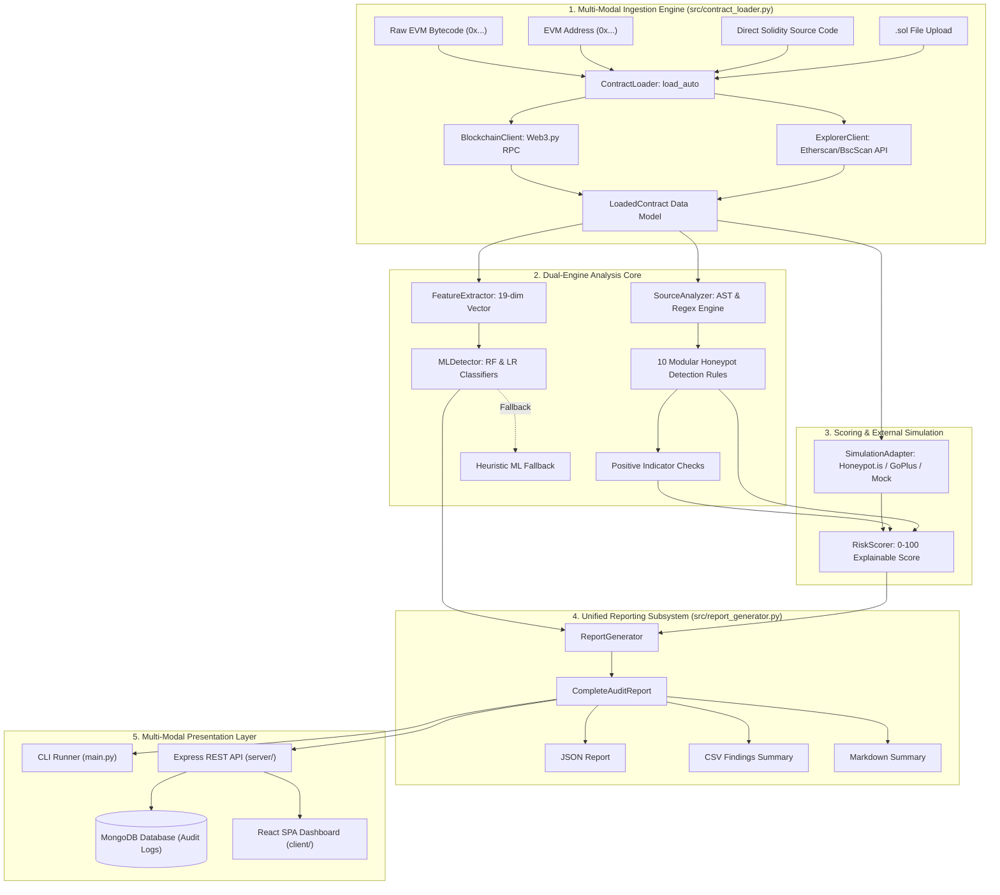
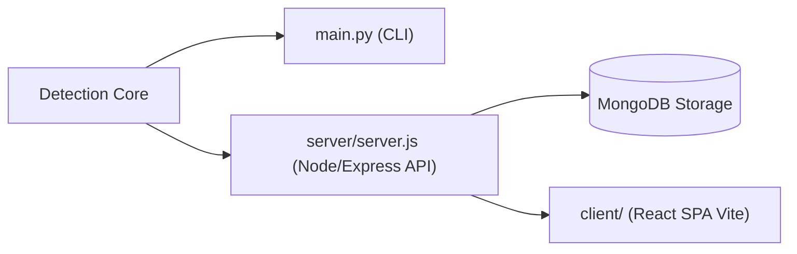
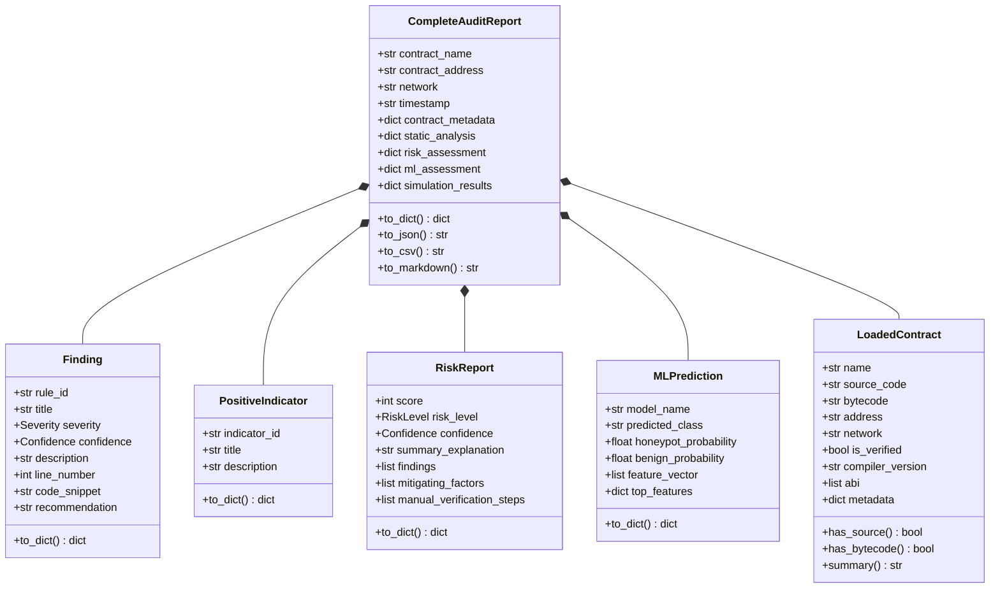

# System Architecture: Blockchain Smart Contract Honeypot Attack Detector

## 1. Executive Overview

The **Blockchain Smart Contract Honeypot Attack Detector** is a modular, dual-engine security auditing platform designed for Cyber Security and Digital Forensics (CSDF) applications. It detects, analyzes, and explains fraudulent EVM smart contracts engineered as "honeypots"—malicious tokens that permit users to purchase or deposit funds while programmatically restricting their ability to sell, withdraw, or transfer tokens.

The system combines:
1. **Rule-Based Static Analysis (Phase 2)**: Deterministic AST and regular expression inspection flagging 10 distinct honeypot attack vectors alongside positive security mitigating indicators.
2. **Machine Learning Classification (Phase 4)**: A 19-dimensional feature extraction pipeline powering scikit-learn Random Forest and Logistic Regression classifiers trained on a curated benchmark dataset of 120 verified tokens.
3. **Dynamic External Simulation (Phase 3)**: Safe off-chain transaction sandbox verification using Honeypot.is, GoPlus Token Security, and offline Mock adapters without executing untrusted bytecode locally.
4. **Multi-Modal Presentation Layer (Phase 6)**: A unified Command-Line Interface (`main.py`) and a production-ready Full MERN Stack application (`server/` Express + MongoDB & `client/` React + Vite).

---

## 2. High-Level Architecture Diagram

---

## 3. Subsystem Breakdown

### 3.1 Ingestion Subsystem (`src/contract_loader.py`, `src/blockchain_client.py`, `src/explorer_client.py`)

- **`ContractLoader`**: Central orchestrator implementing heuristic input routing (`load_auto`):
  - File paths (`.sol`) &rarr; Read safely with `read_file_safe()`, extracting pragmas and contract names.
  - Direct source strings &rarr; Strips comments while preserving line indices to maintain forensic line tracking.
  - EVM addresses (42-character `0x` hex) &rarr; Queries `ExplorerClient` for verified source; if unverified, falls back to `BlockchainClient` for on-chain bytecode.
  - Raw bytecode strings &rarr; Validates hex formatting and stores raw opcode payload.
- **`BlockchainClient`**: Web3.py client supporting Ethereum Mainnet, BNB Smart Chain, Polygon, Arbitrum One, and Sepolia Testnet. Retrieves code size, contract bytecode, account balances, and ERC-20 metadata (safely decoding both standard UTF-8 string and legacy `bytes32` formats).
- **`ExplorerClient`**: Interacts with Etherscan-compatible APIs (Etherscan, BscScan, PolygonScan, Arbiscan) with automatic decompression and flattening of Standard-JSON multi-file verified source contracts.

### 3.2 Static Analysis Engine (`src/source_analyzer.py`, `src/detection_rules.py`)

The static analysis engine inspects sanitized Solidity source code through a modular rule-based architecture:
- **`SourceAnalyzer`**: Extracts AST structural metadata including pragma versions, single and multiple inheritance graphs (identifying the primary deployed contract), state variables, function definitions, modifiers, and non-blank/non-comment lines of code (LOC).
- **10 Detection Rules** (each inheriting from `BaseRule`):
  1. `BlacklistLogicRule` (`HONEYPOT_BLACKLIST`): Identifies blacklist mappings, modifier guards (`notBlacklisted`), and conditional reverts during transfers.
  2. `AsymmetricSellRestrictionRule` (`HONEYPOT_SELL_RESTRICTION`): Detects logic permitting token purchases while reverting transfers destined for DEX liquidity pairs (Uniswap, PancakeSwap).
  3. `ExcessiveSellTaxRule` (`HONEYPOT_EXCESSIVE_SELL_TAX`): Detects hardcoded or dynamic transfer taxes $\ge 25\%$, up to confiscatory $99\%$–$100\%$ taxes.
  4. `UnlimitedOwnerTaxRule` (`HONEYPOT_UNLIMITED_OWNER_TAX`): Flags administrative fee setter functions lacking upper bound ceiling checks (`require(tax <= MAX)`).
  5. `TradingCooldownDelayRule` (`HONEYPOT_TRADING_COOLDOWN_DELAY`): Identifies artificial transaction timestamp or block number delay timers trapping token sales.
  6. `PausableTransfersRule` (`HONEYPOT_PAUSABLE_TRANSFERS`): Detects owner-controlled transfer pause flags that freeze trading after liquidity is supplied.
  7. `MaxWalletTxLimitRule` (`HONEYPOT_MAX_WALLET_TX_LIMIT`): Flags micro-transaction ceilings (e.g., $1$ wei or $< 0.01\%$ supply) that render token liquidation impossible.
  8. `HiddenMintPrivilegeRule` (`HONEYPOT_HIDDEN_MINT`): Detects owner-gated mint functions declared outside the constructor, permitting arbitrary supply dilution.
  9. `SuspiciousAssemblyRule` (`HONEYPOT_SUSPICIOUS_ASSEMBLY`): Identifies inline EVM assembly blocks, low-level delegatecalls, and selfdestruct operations.
  10. `ExternalRestrictionCallRule` (`HONEYPOT_EXTERNAL_RESTRICTION_CALL`): Detects dynamic external contract or oracle calls embedded in transfer routines that can arbitrarily revert sales.
- **Positive Security Indicators** (`check_positive_indicators`): Identifies standard OpenZeppelin imports, immutable fee caps, renounced ownership capability, and standard ERC-20 event emissions.

### 3.3 19-Dimensional Feature Extraction & Machine Learning (`src/feature_extractor.py`, `src/ml_detector.py`, `ml/`)

- **`FeatureExtractor`**: Transforms raw Solidity source code or `LoadedContract` instances into an ordered 19-dimensional numeric feature vector:
  1. `lines_of_code`
  2. `num_functions`
  3. `num_modifiers`
  4. `has_transfer_function`
  5. `has_owner_control`
  6. `has_blacklist_mapping`
  7. `has_sell_restriction_logic`
  8. `has_excessive_fee`
  9. `has_unbounded_fee_setter`
  10. `has_cooldown_delay`
  11. `has_pausable_transfers`
  12. `has_max_tx_wallet_limit`
  13. `has_hidden_mint`
  14. `has_inline_assembly`
  15. `has_external_transfer_call`
  16. `num_positive_indicators`
  17. `has_openzeppelin_imports`
  18. `has_renounce_ownership`
  19. `num_total_findings`
- **Trained Classifiers**:
  - **Random Forest**: Ensemble of 100 decision trees trained on `sample_contract_features.csv` (120 annotated tokens), achieving high ROC-AUC and precision.
  - **Logistic Regression**: Linear baseline with L2 regularization and feature coefficient explainability.
- **Inference Engine (`MLDetector`)**:
  - Automatically loads persisted `.joblib` models from `models/`.
  - Scales feature vectors using `scaler.joblib`.
  - Calculates honeypot probability ($0.0$ to $1.0$) and predicts class (`HONEYPOT` vs `BENIGN`).
  - Identifies top feature attribution drivers contributing to the classification.
  - Provides a deterministic heuristic fallback if serialized model artifacts are unavailable.

### 3.4 Risk Scoring Subsystem (`src/risk_scorer.py`)

Calculates a normalized, explainable risk score ($0$–$100$) by combining static findings with mitigating factors:
- **Base Severity Weights**:
  - `CRITICAL`: $40$ points
  - `HIGH`: $25$ points
  - `MEDIUM`: $15$ points
  - `LOW`: $5$ points
- **Mitigating Deductions**: Each detected positive indicator reduces the score by $5$ points, strictly capped at a maximum deduction of $15$ points.
- **Critical Finding Security Floor**: If at least one `CRITICAL` finding is present, the final risk score is guaranteed to remain $\ge 50$, preventing dangerous honeypots from masking behind surface-level positive indicators.
- **Score Clamping**: The raw score is clamped to the range $[0, 100]$.
- **Risk Bands**:
  - `LOW`: $0$–$24$ points
  - `MODERATE`: $25$–$49$ points
  - `HIGH`: $50$–$74$ points
  - `CRITICAL`: $75$–$100$ points

### 3.5 External Simulation Adapter (`src/simulation_adapter.py`)

Provides transaction-level buy/sell verification without executing untrusted bytecode in the local runtime:
- **Providers**: Honeypot.is API, GoPlus Token Security API, and offline Mock provider.
- **Auto-Fallback**: Cascades through configured providers if external network calls encounter rate limits or timeouts.
- **Metrics Collected**: Buy gas, sell gas, buy tax percentage, sell tax percentage, honeypot verdict, and error failure reasons.

### 3.6 Reporting Subsystem (`src/report_generator.py`)

Serializes complete forensic audit findings into standardized output formats:
- **JSON**: Machine-readable, schema-validated report containing contract metadata, structural analysis, findings with line numbers, positive indicators, risk scores, ML predictions, simulation results, and timestamp.
- **CSV**: Tabular findings export with severity badges and code evidence, plus batch CSV export (`save_batch_csv`) for aggregating multi-contract scanning campaigns.
- **Markdown**: Formatted executive summary suitable for terminal rendering and forensic audit documentation.

---

## 4. User Presentation Interfaces

### 4.1 Command-Line Interface (`main.py`)
- Built with `argparse` and `rich.console`.
- Supports `--file`, `--address`, `--network`, `--code`, `--output`, `--csv-output`, `--train-ml`, and `--simulate`.
- Automatically reconfigures Windows console UTF-8 encoding.
- Returns standard exit codes: `0` (Clean/Low risk), `1` (Honeypot/High risk), `2` (Argument or loading error).

### 4.2 Full MERN Stack Web Application (`server/` + `client/`)
- **Backend (`server/`)**: Express.js REST API with Mongoose ORM connecting to MongoDB (`mongodb://localhost:27017/honeypot_detector`). Persists audit logs, executes Python auditing engine routines, and serves statistical aggregations.
- **Frontend (`client/`)**: Modern React 18 single-page application built with Vite, styled with a sleek dark-mode glassmorphic palette (`#070b14`), custom animated SVG speedometer gauges, interactive audit history logs, and 1-click JSON/CSV forensic artifact export.
- **Python Bridge (`app.py`)**: Dedicated forensic execution bridge providing `execute_contract_audit()` and standalone HTTP server capabilities for direct API invocation.

---

## 5. Core Data Models

---

## 6. Security & Operational Boundaries

1. **Zero Execution of Untrusted Bytecode**: The detection pipeline never deploys or executes submitted Solidity source code or EVM bytecode inside a local EVM. All analysis is performed statically or via sandboxed, read-only third-party simulation endpoints.
2. **Credential Safety**: The system operates exclusively via public JSON-RPC nodes and explorer endpoints; it does not request, store, or accept user private keys, seed phrases, or wallet connections.
3. **Graceful Offline Degradation**: All network dependencies (Web3 RPC, Etherscan API, simulation endpoints) feature automatic offline fallbacks, allowing complete static analysis and ML scoring to function without an internet connection.
