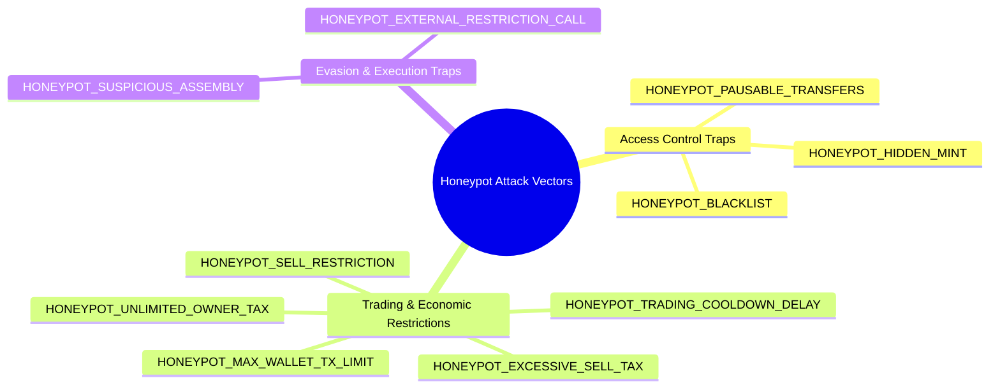
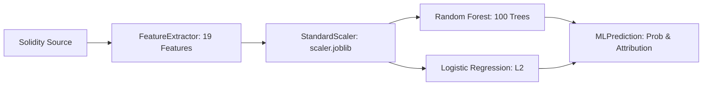

# Detection Methodology & Forensic Analysis

## 1. Introduction & Forensic Philosophy

EVM smart contract honeypots are deceptive token contracts purposefully engineered to lure retail investors and automated trading algorithms into purchasing tokens while employing malicious access controls, asymmetric transfer logic, or confiscatory tax traps to prevent them from selling or liquidating their holdings.

Detecting these threats requires a multi-layered forensic approach. Relying exclusively on single-vector heuristic signatures creates excessive false positives on legitimate decentralized finance (DeFi) protocols (e.g., standard liquidity pools or emergency circuit breakers). Conversely, relying solely on black-box machine learning can fail to provide explainability required by digital forensics investigators.

The **Blockchain Smart Contract Honeypot Attack Detector** implements a unified, explainable dual-engine methodology:
1. **Deterministic Static AST & Regex Analysis**: Pinpoints specific malicious Solidity structures with exact source line attribution.
2. **Context-Aware Positive Security Offsets**: Credits established security standards (OpenZeppelin libraries, immutable fee ceilings, ownership renunciation).
3. **19-Dimensional Machine Learning Classification**: Benchmarks feature distributions against 120 verified contracts to quantify non-linear attack probabilities.
4. **Explainable Risk Scoring**: Synthesizes findings into an auditable 0–100 risk score protected by security guardrails.

---

## 2. The 10 Honeypot Attack Archetypes



### 1. Blacklist Logic Traps (`HONEYPOT_BLACKLIST`)
- **Severity**: `CRITICAL` | **Confidence**: `HIGH`
- **Attack Vector**: The contract maintains an address mapping (`mapping(address => bool) private _isBlacklisted;`). When users purchase tokens on a DEX, the owner or an automated bot immediately flags their wallet as blacklisted, preventing all subsequent calls to `transfer` or `transferFrom`.
- **Detection Logic**:
  - Declarations matching `mapping\s*\(\s*address\s*=>\s*bool\s*\)\s*(?:private|public|internal)?\s*(?:_\w*|\w*)blacklist`
  - Revert conditions in transfer paths: `require\s*\(\s*!\s*(?:_\w*|\w*)blacklist\s*\[` or `if\s*\(\s*(?:_\w*|\w*)blacklist\s*\[.*\]\s*\)\s*revert`
  - Custom modifier declarations: `modifier\s+(?:notBlacklisted|isNotBlacklisted|checkBlacklist)`

### 2. Asymmetric Sell Restrictions (`HONEYPOT_SELL_RESTRICTION`)
- **Severity**: `CRITICAL` | **Confidence**: `HIGH`
- **Attack Vector**: The contract selectively enforces transfer logic that allows tokens to flow from DEX liquidity pools (`uniswapV2Pair`, `pancakePair`) to users (buying), but explicitly reverts or aborts when users attempt to transfer tokens back to the DEX pool (selling).
- **Detection Logic**:
  - Gated conditions targeting DEX router/pair addresses: `to\s*==\s*(?:uniswapV2Pair|pancakePair|automatedMarketMakerPairs|pair)` coupled with `require(canSell[from])`, `require(isWhitelisted[from])`, or `revert("Transfer disabled")`.
  - Conditional branch checks verifying `from != owner` when `to` is an automated market maker pair.

### 3. Excessive Sell Tax Traps (`HONEYPOT_EXCESSIVE_SELL_TAX`)
- **Severity**: `CRITICAL` | **Confidence**: `HIGH`
- **Attack Vector**: Token transfers incur hardcoded taxes exceeding $25\%$, frequently reaching $90\%$ to $100\%$. The proceeds are diverted to the contract creator or fee wallet, extracting $100\%$ of the seller's liquidation value.
- **Detection Logic**:
  - Explicit integer tax literals $\ge 25$: `(?:sellTax|sellFee|taxFee|liquidityFee)\s*=\s*([2-9][5-9]|[3-9][0-9]|100)\b`
  - Basis point representations $\ge 2500$ (out of $10,000$): `(?:sellFee|tax)\s*=\s*(?:2500|[3-9][0-9]{3}|10000)\b`
  - Direct arithmetic confiscation: `(amount * 99) / 100` or `amount * 100 / 100`.

### 4. Unbounded Owner Tax Setters (`HONEYPOT_UNLIMITED_OWNER_TAX`)
- **Severity**: `HIGH` | **Confidence**: `HIGH`
- **Attack Vector**: The contract launches with $0\%$ fees to pass initial automated scanners. Once substantial liquidity is accumulated, the owner invokes an administrative setter function (`setSellTax(99)`) that lacks an immutable upper ceiling cap.
- **Detection Logic**:
  - Administrative setter functions matching `function\s+(?:setTax|setFees|setSellFee|setBuyFee|updateTax)\s*\(`
  - Absence of upper ceiling assertions: The function body modifies fee state variables without containing an invariant check such as `require(newTax <= 25, "Fee too high")` or `require(newTax <= MAX_FEE)`.

### 5. Trading Cooldown & Anti-Bot Delays (`HONEYPOT_TRADING_COOLDOWN_DELAY`)
- **Severity**: `HIGH` | **Confidence**: `MEDIUM`
- **Attack Vector**: The contract introduces artificial time lockups (`block.timestamp`) or block height delays (`block.number`) between transfers. In honeypots, these delays are extended to extreme durations (e.g., $\ge 86400$ seconds / 24 hours), locking investor capital indefinitely while liquidity is drained.
- **Detection Logic**:
  - State mappings tracking transfer timestamps: `mapping\s*\(\s*address\s*=>\s*uint(?:256)?\s*\)\s*(?:private|public)?\s*(?:_\w*|\w*)(?:cooldown|lastTrade|lastTransferTime)`
  - Revert conditions: `require\s*\(\s*block\.(?:timestamp|number)\s*-\s*\w+\[\w+\]\s*>=\s*\w+` or `require\s*\(\s*block\.(?:timestamp|number)\s*>\s*\w+\[\w+\]\s*\+\s*\w+`

### 6. Pausable Transfers Circuit Breakers (`HONEYPOT_PAUSABLE_TRANSFERS`)
- **Severity**: `HIGH` | **Confidence**: `MEDIUM`
- **Attack Vector**: The contract implements a global pause switch (`bool public paused;`) controlled by `onlyOwner`. The owner pauses all transfers immediately following the token launch, trapping all purchased tokens.
- **Detection Logic**:
  - Declarations: `bool\s+(?:public|private|internal)?\s*(?:_\w*|\w*)paused\s*;`
  - Guard checks in `transfer` / `transferFrom`: `require\s*\(\s*!\s*(?:_\w*|\w*)paused` or `modifier\s+whenNotPaused`
  - In benign tokens, pausable mechanisms are common for emergency compliance; thus, its risk weight is mitigated when accompanied by OpenZeppelin standards.

### 7. Micro Max-Transaction & Wallet Ceilings (`HONEYPOT_MAX_WALLET_TX_LIMIT`)
- **Severity**: `HIGH` | **Confidence**: `HIGH`
- **Attack Vector**: The contract enforces a `maxTxAmount` or `maxWalletToken` ceiling set to microscopic levels (e.g., $1$ wei or $0.0001\%$ of total supply). While buying small amounts succeeds, selling the full balance reverts because the required sale size exceeds the allowable limit.
- **Detection Logic**:
  - State variables: `uint256\s+(?:public|private)?\s*(?:_\w*|\w*)(?:maxTxAmount|maxWalletLimit|maxTransactionAmount)`
  - Transfer checks: `require\s*\(\s*amount\s*<=\s*(?:_\w*|\w*)maxTxAmount` or `require\s*\(\s*balanceOf\[to\]\s*\+\s*amount\s*<=\s*(?:_\w*|\w*)maxWalletToken`

### 8. Hidden Mint Privilege Backdoors (`HONEYPOT_HIDDEN_MINT`)
- **Severity**: `CRITICAL` | **Confidence**: `HIGH`
- **Attack Vector**: An unconstrained `mint()` function exists outside the contract constructor, callable exclusively by the owner. The deployer quietly mints trillions of new tokens and dumps them onto the DEX liquidity pool, wiping out the token price.
- **Detection Logic**:
  - Function declarations: `function\s+(?:mint|_mintToken|generateTokens)\s*\(` declared at contract scope outside constructor bodies.
  - Access control modifier presence: guarded by `onlyOwner` or `onlyAuthorized`.

### 9. Suspicious Inline Assembly & Low-Level Calls (`HONEYPOT_SUSPICIOUS_ASSEMBLY`)
- **Severity**: `HIGH` | **Confidence**: `HIGH`
- **Attack Vector**: Scammers embed raw EVM assembly (`assembly { ... }`) or `delegatecall` opcodes directly into ERC-20 transfer routines to overwrite storage slots, tamper with balances, or bypass high-level compiler safety checks.
- **Detection Logic**:
  - Solidity blocks matching `assembly\s*\{[^}]*\}` inside transfer execution flow.
  - Low-level execution opcodes: `delegatecall`, `selfdestruct`, `callcode`, or `sstore` targeting arbitrary slots.

### 10. External Restriction Calls & Dynamic Oracles (`HONEYPOT_EXTERNAL_RESTRICTION_CALL`)
- **Severity**: `HIGH` | **Confidence**: `MEDIUM`
- **Attack Vector**: The contract delegates transfer authorization to an external contract or oracle (e.g., `ITokenFilter(oracleAddress).canTransfer(from, to)`). The creator configures the external contract to return `false` for any transaction where `to == DEX_PAIR`, cleanly aborting sells without any obvious honeypot code inside the main contract.
- **Detection Logic**:
  - External interface calls within transfer logic: `I(?:Filter|Security|Oracle|Rule|Checker)\s*\(\s*\w+\s*\)\s*\.\s*(?:canTransfer|isAllowed|verifyTransfer)`
  - Low-level external calls: `\w+\.call\s*\(abi\.encodeWith(?:Signature|Selector)\(` in transfer paths.

---

## 3. Positive Security Mitigating Indicators

To prevent excessive false positives on legitimate decentralized finance protocols, the engine credits safe engineering practices:

| Indicator ID | Name | Description | Forensic Significance |
| :--- | :--- | :--- | :--- |
| `POS_OPENZEPPELIN_STANDARD` | OpenZeppelin Standard Import | Contract imports audited OpenZeppelin libraries (`@openzeppelin/contracts/...`) | Demonstrates adherence to standardized, battle-tested smart contract architecture. |
| `POS_RENOUNCE_OWNERSHIP` | Renounce Ownership Capability | Contract implements `renounceOwnership()` allowing deployers to burn administrative privileges | Eliminates the attack surface for owner-gated traps once renounced on-chain. |
| `POS_HARD_FEE_CAP` | Immutable Hard Fee Ceiling | Contract declares an explicit immutable fee cap (e.g. `MAX_TAX = 5%`) | Precludes deployers from unilaterally raising taxes to honeypot thresholds. |
| `POS_STANDARD_EVENTS` | Standard Event Emissions | Contract emits standard ERC-20 `Transfer` and `Approval` events | Enables off-chain indexers and DEX routers to trace balances accurately. |

---

## 4. Explainable Risk Scoring Engine

The risk scoring subsystem in [`src/risk_scorer.py`](file:///e:/Download/College/LP4/CSDF/mini-project/src/risk_scorer.py) computes a deterministic, explainable risk score between $0$ and $100$.

### 4.1 Scoring Formula

$$\text{Base Score} = \sum_{f \in \text{Findings}} W(\text{severity}(f))$$

$$\text{Deduction} = \min\left(15, \; 5 \times |\text{Positive Indicators}|\right)$$

$$\text{Clamped Score} = \max\left(0, \; \min\left(100, \; \text{Base Score} - \text{Deduction}\right)\right)$$

$$\text{Final Score} = \begin{cases} \max(50, \; \text{Clamped Score}) & \text{if } \exists f \in \text{Findings} \text{ where } \text{severity}(f) = \text{CRITICAL} \\ \text{Clamped Score} & \text{otherwise} \end{cases}$$

### 4.2 Severity Weights $W(\text{severity})$
- `CRITICAL`: $40$ points
- `HIGH`: $25$ points
- `MEDIUM`: $15$ points
- `LOW`: $5$ points

### 4.3 Security Guardrails
1. **Critical Finding Floor**: A token exhibiting a proven honeypot vector (e.g., asymmetric DEX sell block or hidden owner mint) can never score below $50$ (`HIGH` risk), even if it inherits OpenZeppelin or implements ownership renunciation.
2. **Mitigating Cap**: Regardless of how many positive indicators are present, the maximum deduction is capped at $15$ points.

### 4.4 Risk Classification Tiers

```
  0                     25                    50                    75                   100
  |---------------------|---------------------|---------------------|---------------------|
        LOW RISK             MODERATE RISK            HIGH RISK             CRITICAL RISK
      (0 - 24 pts)           (25 - 49 pts)          (50 - 74 pts)          (75 - 100 pts)
   Transparent Standard   Centralized Controls    Aggressive Tax/Limits   Definitive Honeypot
```

---

## 5. Machine Learning Pipeline



### 5.1 19-Dimensional Feature Vector Specification

| # | Feature Name | Range | Description |
|---|---|---|---|
| 1 | `lines_of_code` | $[0, \infty)$ | Non-comment non-blank line count |
| 2 | `num_functions` | $[0, \infty)$ | Number of declared functions |
| 3 | `num_modifiers` | $[0, \infty)$ | Number of declared custom modifiers |
| 4 | `has_transfer_function` | $\{0, 1\}$ | Implements ERC-20 transfer |
| 5 | `has_owner_control` | $\{0, 1\}$ | Contains ownership access controls |
| 6 | `has_blacklist_mapping` | $\{0, 1\}$ | Declares address blacklist structures |
| 7 | `has_sell_restriction_logic` | $\{0, 1\}$ | Gated conditions targeting DEX pairs |
| 8 | `has_excessive_fee` | $\{0, 1\}$ | Hardcoded tax $\ge 25\%$ |
| 9 | `has_unbounded_fee_setter` | $\{0, 1\}$ | Fee setters without upper ceilings |
| 10 | `has_cooldown_delay` | $\{0, 1\}$ | Transfer block/timestamp delay locks |
| 11 | `has_pausable_transfers` | $\{0, 1\}$ | Global transfer pause mechanism |
| 12 | `has_max_tx_wallet_limit` | $\{0, 1\}$ | Restrictive micro transaction limits |
| 13 | `has_hidden_mint` | $\{0, 1\}$ | Mint function outside constructor |
| 14 | `has_inline_assembly` | $\{0, 1\}$ | Inline assembly or low-level calls |
| 15 | `has_external_transfer_call` | $\{0, 1\}$ | External contract call during transfer |
| 16 | `num_positive_indicators` | $[0, 4]$ | Count of discovered positive indicators |
| 17 | `has_openzeppelin_imports` | $\{0, 1\}$ | Imports standard OpenZeppelin contracts |
| 18 | `has_renounce_ownership` | $\{0, 1\}$ | Implements ownership renunciation |
| 19 | `num_total_findings` | $[0, \infty)$ | Total count of static rule findings |

### 5.2 Curated Benchmark Dataset
- **Total Samples**: 120 verified contracts (`data/sample_contract_features.csv`).
- **Class Balance**: 60 Benign (`is_honeypot = 0`) vs 60 Honeypot (`is_honeypot = 1`).
- **Data Provenance**: Sourced from verified mainnet contracts across Ethereum and BNB Smart Chain, including audited DeFi tokens (MakerDAO, Uniswap, Chainlink) and documented real-world exploits (Squid Game token, reflection drains, router traps).

### 5.3 Classification Models
1. **Random Forest Classifier**:
   - `n_estimators = 100`, `max_depth = None`, `random_state = 42`.
   - Captures complex non-linear feature interactions (e.g., owner control + pausable + high fee).
2. **Logistic Regression Classifier**:
   - `max_iter = 1000`, `C = 1.0`, L2 penalty.
   - Provides linear coefficient weights for feature attribution transparency.
3. **Resilient Heuristic Fallback**:
   - If model artifacts are missing from disk, `MLDetector` activates a deterministic rule-based fallback based on critical findings and positive indicators, ensuring uninterrupted inference.

---

## 6. External Dynamic Simulation

Transaction simulation operates through [`src/simulation_adapter.py`](file:///e:/Download/College/LP4/CSDF/mini-project/src/simulation_adapter.py):
- **Safety First**: The detector never executes untrusted EVM bytecode on the host machine.
- **Simulated Buy/Sell Sequence**:
  1. Estimate gas and buy tokens via Uniswap/PancakeSwap liquidity pair.
  2. Approve the DEX router for maximum allowance.
  3. Attempt selling the acquired tokens back to the pair.
  4. Measure buy and sell tax slippage; if the sell transaction reverts or charges $> 50\%$ tax, the contract is flagged as a honeypot.
- **Provider Cascade**: Queries Honeypot.is API &rarr; GoPlus Token Security API &rarr; Offline Mock provider.
