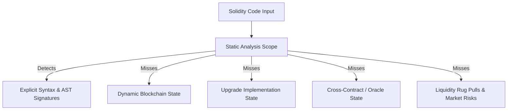
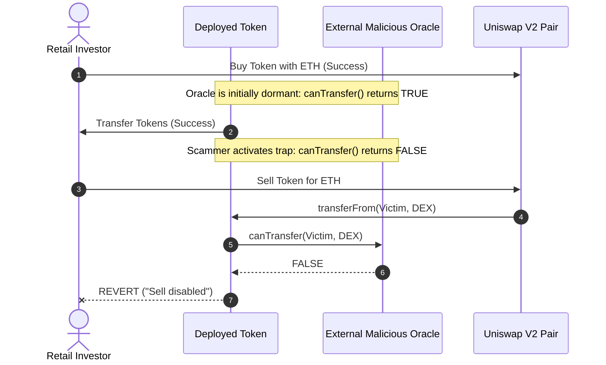

# Limitations, False Positives & Forensic Guidelines

## 1. Executive Disclaimer

> [!WARNING]
> The **Blockchain Smart Contract Honeypot Attack Detector** is a forensic decision-support and educational auditing platform. All outputs, risk scores, and machine learning probabilities must be treated as **indicators of potential risk**, not definitive legal or mathematical proof of malicious intent. Conversely, a **LOW RISK** score does not guarantee that a contract is safe, solvent, or devoid of economic attack vectors.

Smart contract security is an adversarial domain where attackers continually adapt their techniques to evade static analysis heuristics. This document formally delineates the technical limitations, false-positive scenarios, evasion tactics, and recommended verification steps for investigators.

---

## 2. Technical Boundaries of Static Source Analysis

### 2.1 Absence of a Local EVM Execution Sandbox
By design, the detector **never compiles or executes untrusted bytecode locally**. While this architectural boundary protects the auditor's host machine from potential zero-day vulnerabilities in local compilers or virtual machines, it means the tool cannot:
- Dynamically observe contract execution traces across arbitrary state transitions.
- Evaluate branch conditions that depend on dynamic runtime variables (e.g., `block.timestamp`, `block.prevrandao`, or fluctuating AMM reserves).
- Trace complex reentrancy or state rollback conditions.

### 2.2 Regex & AST Heuristic Boundaries
- **Function Overriding & Polymorphism**: Deep multi-contract inheritance hierarchies with nested function overrides can obscure the true execution path of an internal `_transfer()` function.
- **Obfuscated Variable Naming**: Attackers can substitute standard identifiers (e.g., `_isBlacklisted`) with deceptive names (e.g., `_rewardTier`, `_eligibleHolders`, or arbitrary hashes `mapping(address => uint256) private _m01;`).
- **Inline Assembly EVM Obfuscation**: Low-level assembly blocks (`assembly { sstore(...) }`) can manipulate internal storage slots directly, modifying token balances or transfer permissions without triggering high-level AST keyword rules.

### 2.3 Proxy & Upgradable Architectures
Many modern DeFi tokens utilize proxy patterns (ERC-1967 Transparent Proxies, UUPS, or Beacon Proxies). In these setups:
- The deployed address ingested by the detector contains only a minimal dispatcher contract delegating all calls to an implementation address (`delegatecall`).
- If the audited contract is a proxy, static analysis of the proxy source code will show clean, benign forwarding logic, while the true malicious honeypot logic resides in the unlinked implementation contract.

### 2.4 Distributed Multi-Contract Architecture
Attackers can distribute honeypot logic across separate contracts:
- Contract A (the token) is written to appear completely benign.
- Contract A delegates transfer validation to Contract B (a filter, treasury, or external oracle).
- Contract B is deployed separately and can be instructed to revert sells after initial liquidity is added.

---

## 3. False Positive Analysis (Benign Patterns Flagged)

A false positive occurs when the detector flags a benign, audited, or standard DeFi contract as high risk. The table below details common benign occurrences and their underlying causes:

| Pattern | Rule Flagged | Why It Appears Suspicious | Why It May Be Benign |
| :--- | :--- | :--- | :--- |
| **Institutional Stablecoins (USDC, USDT)** | `HONEYPOT_BLACKLIST` | Contains address blacklisting and freeze functions. | Required for compliance with legal mandates, regulatory sanctions (OFAC), and law enforcement requests. |
| **DEX Router / AMM Liquidity Pairs** | `HONEYPOT_SELL_RESTRICTION` | Reverts transfers directly targeting liquidity pool reserves. | Protects automated market maker math (x * y = k) from unauthorized direct balance manipulation. |
| **Deflationary / Staking Tokens** | `HONEYPOT_EXCESSIVE_SELL_TAX` | Charges fees on transfers (e.g., 5% reflection to stakers, 2% burn). | Legitimate economic design intended to fund rewards, liquidity growth, or burn mechanisms. |
| **Emergency Circuit Breakers** | `HONEYPOT_PAUSABLE_TRANSFERS` | Contains a global `paused` flag that stops token transfers. | Industry standard safety feature used by protocols to freeze activity during an active exploit or hack. |
| **Anti-Whale Launch Mechanics** | `HONEYPOT_MAX_WALLET_TX_LIMIT` | Restricts maximum transaction amount or wallet holding capacity. | Legitimate measure used during fair token launches to prevent sniper bots from cornering total supply. |

---

## 4. False Negative Analysis (Malicious Evasion Tactics)

A false negative occurs when a malicious honeypot contract evades static detection rules and receives an artificially low risk score:

### 4.1 Off-Chain Dynamic Oracle Manipulation
- **Mechanism**: The token queries an external oracle (`require(IOracle(oracle).isApproved(from))`). During the initial launch phase, the oracle returns `true` for all transactions to pass automated honeypot scanners (e.g., Honeypot.is, DexScreener). Once sufficient liquidity is deposited, the oracle switches off sell permissions for non-whitelisted addresses.
- **Detector Impact**: The static analyzer notes an external call (`HONEYPOT_EXTERNAL_RESTRICTION_CALL`), but because the source code itself contains no hardcoded blacklist mapping, the total score may remain moderate rather than critical.

### 4.2 Economic Liquidity Rug Pulls
- **Mechanism**: The smart contract code is 100% standard ERC-20 with zero transfer restrictions or taxes. However, the deployer holds 99% of the Uniswap Liquidity Provider (LP) tokens and abruptly withdraws all underlying ETH or USDC from the pool.
- **Detector Impact**: Pure static analysis will score this token as `LOW RISK` (0–10/100) because the token contract itself is benign; the attack occurs at the AMM liquidity level, not in the token logic.

### 4.3 Compiler-Specific Bugs & Assembly Storage Exploits
- **Mechanism**: Attackers leverage compiler-specific storage layout quirks or low-level assembly to disguise variable writes. For example, writing to slot 0 (`sstore(0, 1)`) to set a pause flag without referencing the `paused` variable name in Solidity.
- **Detector Impact**: High-level regular expressions and AST parsers will fail to link the storage write to the transfer freeze mechanism.

---

## 5. Security & Operational Boundaries

1. **Read-Only Inspection**: The system performs read-only queries against public blockchain nodes and block explorer APIs. It never connects to Web3 browser wallets, requests private keys, signs transactions, or broadcasts state-changing operations.
2. **Rate Limits & API Quotas**: On-chain source retrieval (`ExplorerClient`) relies on third-party APIs (Etherscan, BscScan). Under strict free-tier rate limits (5 requests/sec), multi-file contract verification may experience latency or intermittent rate-limit warnings.
3. **Unverified Source Code**: If a contract address is audited and its source code has not been submitted and verified on a block explorer, the detector falls back to bytecode-only analysis. In bytecode mode, high-level AST rules are skipped, and feature metrics are conservatively estimated.

---

## 6. Forensic Investigator Verification Checklist

When conducting a forensic audit of an unknown or suspicious smart contract, investigators must complete the following manual checks alongside automated detector reports:

- [ ] **1. Contract Verification**: Confirm that the source code verified on Etherscan/BscScan matches the bytecode deployed at the address.
- [ ] **2. Ownership State**: Inspect the current owner address on-chain. Has ownership been renounced to the zero address (`0x0000...0000`) or is it retained by an Externally Owned Account (EOA)?
- [ ] **3. Liquidity Lock**: Check whether LP tokens are permanently locked in a reputable locker (e.g., Unicrypt, PinkSale) or burned to dead addresses.
- [ ] **4. Fee Cap Invariants**: Verify that any fee update function (`setTax`) contains an explicit upper bound (e.g., `require(newTax <= 10)`).
- [ ] **5. External Dependencies**: Inspect all addresses passed into the constructor or setters (routers, oracles, reward distributors). Ensure they point to verified contracts.
- [ ] **6. Simulation Testing**: Run small test transactions (buy and sell) on a local testnet fork (e.g., Anvil or Hardhat) to observe runtime behavior under real DEX liquidity conditions.
- [ ] **7. Multi-Engine Corroboration**: Corroborate results across static analysis, the 19-dimensional ML model, and external transaction simulation.
